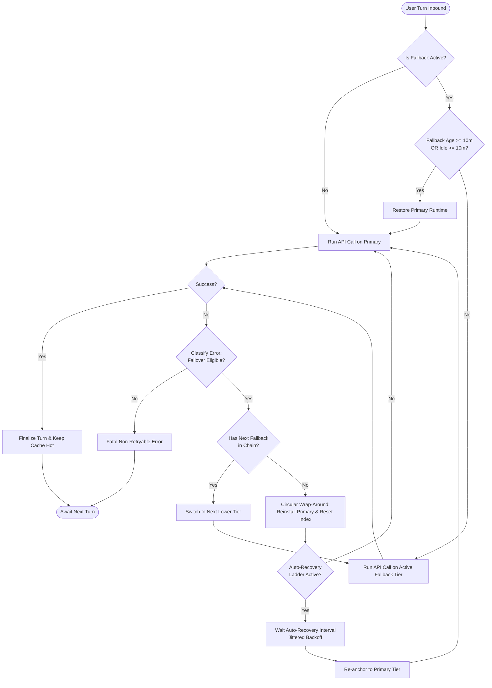

# Resilient Circular Fallback & Prompt-Cache Preservation Architecture

This document outlines the complete architectural design, state machines, and operational logic of the multi-tier LLM fallback system implemented in Hermes Agent.

---

## 1. Architectural Overview & Objectives

The primary objective of this architecture is **uninterrupted chat execution** combined with **prompt-caching cost efficiency**:

1. **Zero-Stall Chat Execution:** Conversations must never block or terminate due to transient API outages, capacity ceilings, or provider errors.
2. **Prompt-Cache Retention:** Model flipping between turns is suppressed while the cache is valid, preserving ~90% prompt-cache discount benefits.
3. **Circular Wrap-Around (No Bottom-Tier Entrapment):** If the chain steps down to the lowest tier and that tier fails, execution must not stall or retry only the bottom tier; it automatically loops back to the primary tier to re-verify availability.
4. **10-Minute Age Restoration:** Because transient surges, rate limits, and spot pricing spikes typically resolve within minutes, a fallback older than 10 minutes automatically attempts primary restoration.

---

## 2. Multi-Tier Fallback Lifecycle Diagram



---

## 3. Core Architectural Components

### 3.1. Dynamic Error Classifier (`agent/error_classifier.py`)
Determines whether an HTTP status code, API exception, or gateway message warrants immediate failover to the next tier:

* **Transport & Capacity Failures:** `500`, `502`, `503`, `504`, `529`, connection drops, read timeouts.
* **Rate Limits:** HTTP `429` (Quota limits, concurrency throttles).
* **Dynamic Marketplace Ceilings:** Automatically reclassifies marketplace dynamic pricing spikes, capacity saturation, and surge thresholds as failover-eligible:
  - `"provider price exceeds"`
  - `"price ceiling exceeded"`
  - `"capacity limit reached"`
  - `"surge pricing active"`

---

### 3.2. Circular Fallback Engine (`agent/chat_completion_helpers.py`)

Handles model switching when an error occurs during an active turn:

```python
# Sequential step-down through the configured tiers
if agent._fallback_index < len(agent._fallback_chain):
    fb = agent._fallback_chain[agent._fallback_index]
    agent._fallback_index += 1
    # Bind candidate tier and resume retry loop...
```

#### Bottom-of-Chain Wrap-Around Logic
When the lowest fallback tier is reached and fails:
1. Detects `agent._fallback_index >= len(agent._fallback_chain)`.
2. Reinstalls the **Primary Runtime snapshot** (`reinstall_runtime_snapshot(agent, agent._primary_runtime)`).
3. Resets `agent._fallback_index = 0`.
4. Clears transient unavailable candidate sets (`agent._unavailable_fallback_keys.clear()`).
5. Resets rate-limit cooldown counters (`agent._rate_limited_until = 0`).
6. Inserts a gentle 1.0-second backoff throttle to prevent high-frequency CPU churn during macro-outages.
7. Emits real-time notification:
   > `🔄 Fallback reached bottom of chain; cycling back to top: <model> via <provider>.`
8. Re-fires the request on the Primary Tier. If Primary fails again, the cycle steps down cleanly (`Primary -> Tier 2 -> Tier 3 -> Bottom -> Primary`).

---

### 3.3. Cache-Aware Sticky Fallback (`agent/agent_runtime_helpers.py`)

Protects prompt caching across consecutive user turns:

```python
FALLBACK_CACHE_STICKY_SECONDS = 600.0  # 10 minutes
```

* **Turn Initialization Hook (`restore_primary_runtime`):**
  - **Within 10 Minutes ($\Delta t < 600\text{s}$):** Hermes stays on the currently active fallback model. The prompt cache on the fallback provider remains warm, ensuring rapid generation and cost savings.
  - **Exceeding 10 Minutes ($\Delta t \ge 600\text{s}$):** 
    - The prompt cache on the fallback model has expired.
    - Higher-tier models and spot marketplace prices have likely stabilized.
    - Hermes automatically restores the Primary Runtime snapshot and clears fallback state.
  - **Age Boundary Check:** Tracks `agent._fallback_activated_at`. Even during rapid multi-turn sessions, if the session has operated on a fallback model for $\ge 10\text{ minutes}$, the primary model is automatically re-tested on the next turn.

---

### 3.4. Auto-Recovery Ladder Integration (`agent/turn_recovery_autorecover.py`)

Governs the bounded countdown ladder when severe network-wide interruptions occur:

1. **Wait Schedule:** Bounded jittered countdown (15s, 30s, 60s...) up to configured recovery cycles.
2. **Top-Tier Re-anchoring:** When a wait countdown finishes (`action == "continue"`):
   - Rather than repeating against the same failing lower tier, it re-anchors `agent` back to **Primary**.
   - Resets `agent._fallback_index = 0`.
   - Every recovery cycle starts clean from Tier 1, cascading downwards only if needed.

---

### 3.5. Dynamic Status Bar Formatter (`hermes_cli/cli_status_bar_mixin.py`)

Provides real-time terminal observability of the active tier:

* Standardizes model name prefixes (e.g. `ds-` prefix formatting).
* Dynamically prepends the active provider tag: `[<Provider>]`.
* Expands the status bar field width (up to 34 chars) so fallback tier transitions are clearly visible during streaming and execution.

---

## 4. State Transition Matrix

| Current State | Event | Next State | Action / Behavior |
| :--- | :--- | :--- | :--- |
| **Primary (Tier 1)** | Request Succeeds | **Primary (Tier 1)** | Turn complete; prompt cache remains on Primary. |
| **Primary (Tier 1)** | Transport / Capacity / Rate Limit Error | **Fallback Tier 2** | Step down; `_fallback_index = 1`; `_fallback_activated = True`. |
| **Fallback Tier $k$** | Request Succeeds (within 10m) | **Fallback Tier $k$** | **Sticky retention:** next turn starts on Tier $k$ (preserves cache). |
| **Fallback Tier $k$** | Failure during execution | **Fallback Tier $k+1$** | Step down to next lower tier in chain. |
| **Bottom Tier ($N$)** | Failure during execution | **Primary (Tier 1)** | **Circular wrap-around:** reset `_fallback_index = 0`, re-probe top tier. |
| **Any Fallback Tier** | Idle $> 10\text{m}$ OR Fallback Age $\ge 10\text{m}$ | **Primary (Tier 1)** | Cache expired / surge cleared; restore primary runtime. |
| **Auto-Recovery Ladder** | Wait cycle countdown completes | **Primary (Tier 1)** | Reset index to 0; retry cycle starts from top tier. |

---

## 5. Architectural Guarantees

1. **Deadlock Immunity:** The system cannot get stuck indefinitely on any intermediate or bottom tier.
2. **Deterministic Bounding:** The 10-minute age ceiling guarantees that cheaper or higher-quality primary models are never orphaned permanently.
3. **Privacy Compliance:** All state handling and route bindings are generic and vendor-agnostic, with zero hardcoded provider names or secrets in the logic.
