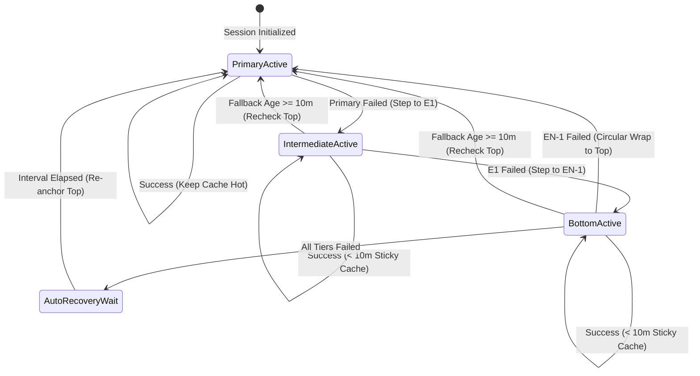
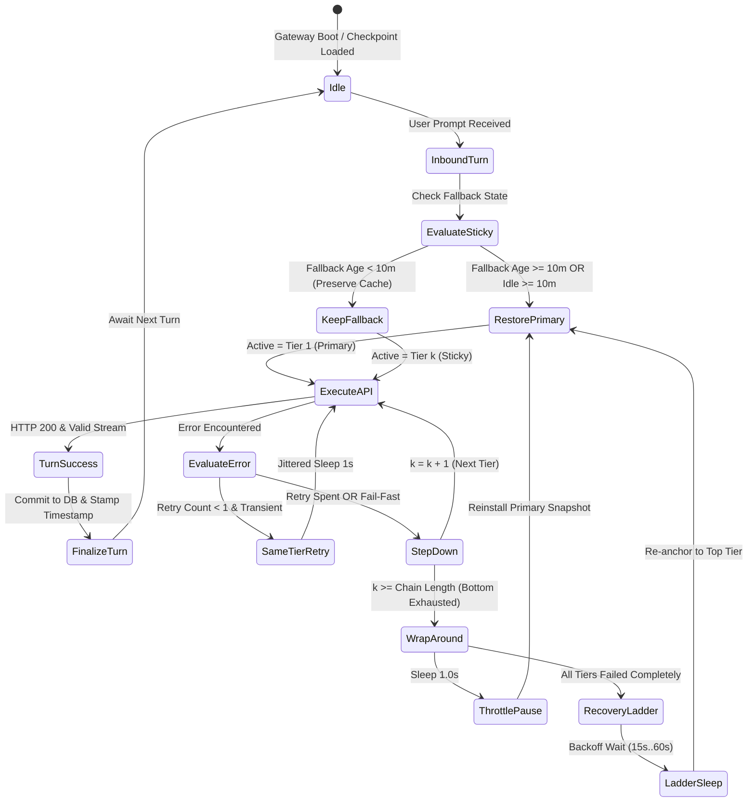
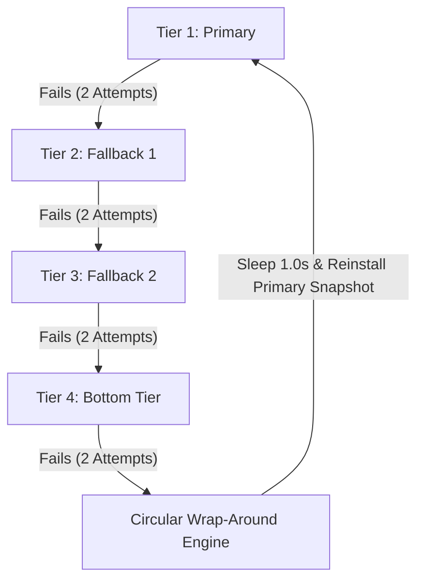
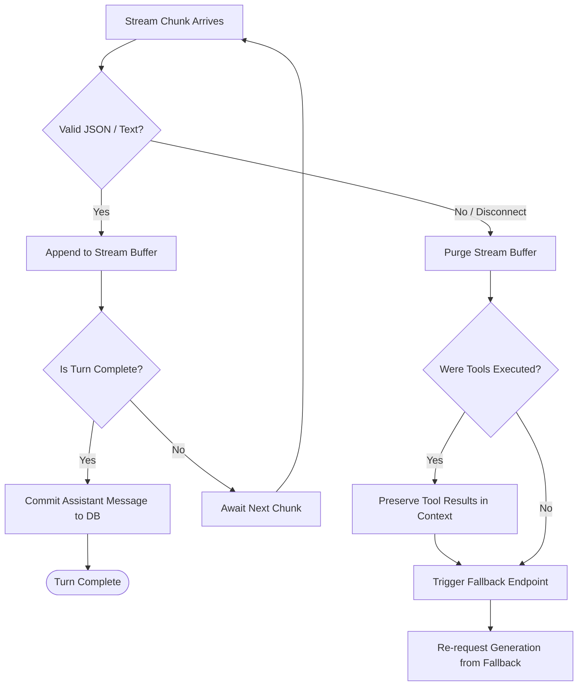
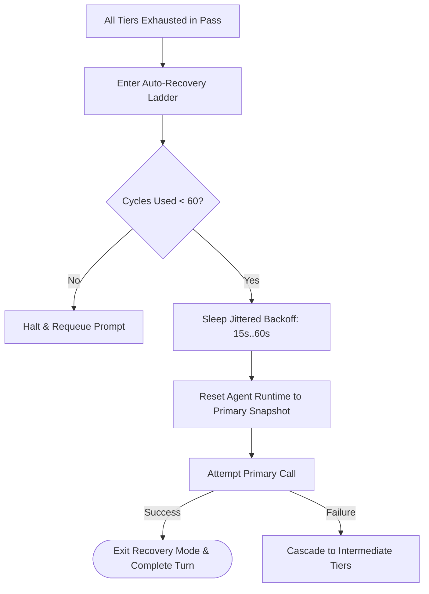
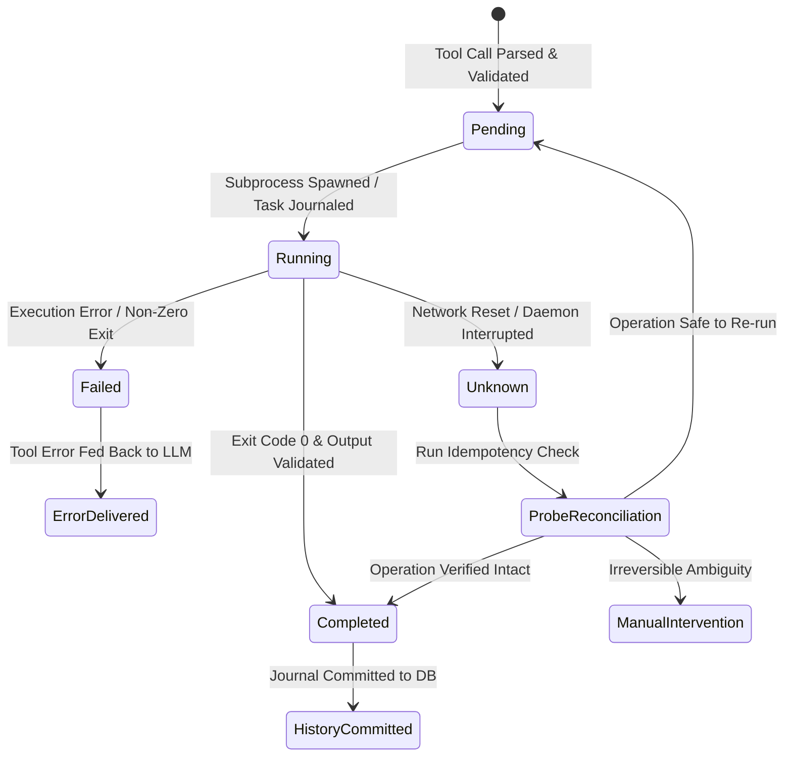

# Hermes Agent Plus — Intelligent Fallback, Retry & Recovery System
## Complete Architectural Specification and Reference Manual

---

# Table of Contents
- [1. Introduction](#1-introduction)
  - [1.1. Purpose and Objectives](#11-purpose-and-objectives)
  - [1.2. Problems with Traditional Fallback Systems](#12-problems-with-traditional-fallback-systems)
  - [1.3. Reliability, Performance, and Cost Optimization](#13-reliability-performance-and-cost-optimization)
  - [1.4. Core Design Principles](#14-core-design-principles)
  - [1.5. System Requirements and Expected Behavior](#15-system-requirements-and-expected-behavior)
- [2. Fallback Architecture](#2-fallback-architecture)
  - [2.1. Primary and Fallback Endpoint Hierarchy](#21-primary-and-fallback-endpoint-hierarchy)
  - [2.2. Circular Fallback vs. Linear Fallback](#22-circular-fallback-vs-linear-fallback)
  - [2.3. Endpoint Selection and Priority Order](#23-endpoint-selection-and-priority-order)
  - [2.4. Active Endpoint State Management](#24-active-endpoint-state-management)
  - [2.5. Provider and Model Capability Compatibility](#25-provider-and-model-capability-compatibility)
  - [2.6. Session-Level vs. Global Fallback State](#26-session-level-vs-global-fallback-state)
  - [2.7. Fallback State Machine](#27-fallback-state-machine)
- [3. Fallback Trigger Conditions](#3-fallback-trigger-conditions)
  - [3.1. When Fallback Should Occur](#31-when-fallback-should-occur)
  - [3.2. When Fallback Should Not Occur](#32-when-fallback-should-not-occur)
  - [3.3. Immediate Fallback Conditions](#33-immediate-fallback-conditions)
  - [3.4. Retry-Before-Fallback Conditions](#34-retry-before-fallback-conditions)
  - [3.5. HTTP Error Classification](#35-http-error-classification)
  - [3.6. Rate Limits and Capacity Exhaustion](#36-rate-limits-and-capacity-exhaustion)
  - [3.7. Marketplace Pricing and Budget Restrictions](#37-marketplace-pricing-and-budget-restrictions)
  - [3.8. Connection Failures and Network Errors](#38-connection-failures-and-network-errors)
  - [3.9. Model-Specific and Provider-Specific Failures](#39-model-specific-and-provider-specific-failures)
  - [3.10. Permanent vs. Temporary Failures](#310-permanent-vs-temporary-failures)
- [4. Same-Endpoint Retry Policy](#4-same-endpoint-retry-policy)
  - [4.1. Maximum Retry Attempts per Endpoint](#41-maximum-retry-attempts-per-endpoint)
  - [4.2. Initial Request and Retry Counting](#42-initial-request-and-retry-counting)
  - [4.3. Default Two-Attempt Policy](#43-default-two-attempt-policy)
  - [4.4. Single-Attempt Fail-Fast Conditions](#44-single-attempt-fail-fast-conditions)
  - [4.5. Retry Delay and Jitter](#45-retry-delay-and-jitter)
  - [4.6. Retry-After Header Handling](#46-retry-after-header-handling)
  - [4.7. Retry Counter Reset Conditions](#47-retry-counter-reset-conditions)
  - [4.8. Retry Limits During Normal Operation](#48-retry-limits-during-normal-operation)
  - [4.9. Retry Limits During Recovery](#49-retry-limits-during-recovery)
  - [4.10. Avoiding Unnecessary API Charges](#410-avoiding-unnecessary-api-charges)
- [5. Timeout Management](#5-timeout-management)
  - [5.1. Connection Establishment Timeout](#51-connection-establishment-timeout)
  - [5.2. Time to First Token (TTFT)](#52-time-to-first-token-ttft)
  - [5.3. Streaming Inactivity Timeout](#53-streaming-inactivity-timeout)
  - [5.4. Reasoning Model Timeout Handling](#54-reasoning-model-timeout-handling)
  - [5.5. Long-Running Request Detection](#55-long-running-request-detection)
  - [5.6. Tool Execution Timeouts](#56-tool-execution-timeouts)
  - [5.7. Provider-Specific Timeout Overrides](#57-provider-specific-timeout-overrides)
  - [5.8. Distinguishing Slow Responses from Failed Responses](#58-distinguishing-slow-responses-from-failed-responses)
- [6. Sticky Fallback and Prompt Cache Preservation](#6-sticky-fallback-and-prompt-cache-preservation)
  - [6.1. Sticky Fallback Concept](#61-sticky-fallback-concept)
  - [6.2. Prompt Cache Preservation Strategy](#62-prompt-cache-preservation-strategy)
  - [6.3. 20-Minute Conversation Inactivity Rule](#63-20-minute-conversation-inactivity-rule)
  - [6.4. Continuous Conversation Behavior](#64-continuous-conversation-behavior)
  - [6.5. Long-Running Agent Tasks](#65-long-running-agent-tasks)
  - [6.6. When to Restore the Primary Endpoint](#66-when-to-restore-the-primary-endpoint)
  - [6.7. Preventing Primary–Fallback Oscillation](#67-preventing-primaryfallback-oscillation)
  - [6.8. Cache Loss vs. Endpoint Pricing Trade-offs](#68-cache-loss-vs-endpoint-pricing-trade-offs)
  - [6.9. Sticky State Persistence Across Restarts](#69-sticky-state-persistence-across-restarts)
  - [6.10. Cache-Aware Endpoint Switching](#610-cache-aware-endpoint-switching)
- [7. Circular Fallback Logic](#7-circular-fallback-logic)
  - [7.1. Initial Endpoint Selection](#71-initial-endpoint-selection)
  - [7.2. Sequential Fallback Traversal](#72-sequential-fallback-traversal)
  - [7.3. Wrapping from Last Fallback to Primary](#73-wrapping-from-last-fallback-to-primary)
  - [7.4. Attempt Tracking Within a Full Pass](#74-attempt-tracking-within-a-full-pass)
  - [7.5. Skipping Temporarily Unavailable Endpoints](#75-skipping-temporarily-unavailable-endpoints)
  - [7.6. Avoiding Infinite Immediate Retry Loops](#76-avoiding-infinite-immediate-retry-loops)
  - [7.7. Selecting the First Successful Endpoint](#77-selecting-the-first-successful-endpoint)
  - [7.8. Making the Recovered Endpoint Sticky](#78-making-the-recovered-endpoint-sticky)
  - [7.9. Circular Fallback Pseudocode](#79-circular-fallback-pseudocode)
- [8. Higher-Priority Endpoint Recovery](#8-higher-priority-endpoint-recovery)
  - [8.1. Rechecking Previously Failed Endpoints](#81-rechecking-previously-failed-endpoints)
  - [8.2. 10-Minute Failure Recheck Threshold](#82-10-minute-failure-recheck-threshold)
  - [8.3. Immediate Recheck After Active Endpoint Failure](#83-immediate-recheck-after-active-endpoint-failure)
  - [8.4. Recovery of Primary During Fallback Operation](#84-recovery-of-primary-during-fallback-operation)
  - [8.5. Recovery of Intermediate Fallbacks](#85-recovery-of-intermediate-fallbacks)
  - [8.6. Why Healthy Fallbacks Should Not Be Interrupted](#86-why-healthy-fallbacks-should-not-be-interrupted)
  - [8.7. Endpoint Cooldown Expiration](#87-endpoint-cooldown-expiration)
  - [8.8. Recovery Without Cache Flapping](#88-recovery-without-cache-flapping)
- [9. Full-Chain Exhaustion and Automatic Recovery](#9-full-chain-exhaustion-and-automatic-recovery)
  - [9.1. Detecting Complete Fallback Chain Exhaustion](#91-detecting-complete-fallback-chain-exhaustion)
  - [9.2. Entering Automatic Recovery Mode](#92-entering-automatic-recovery-mode)
  - [9.3. Restarting Recovery from Primary](#93-restarting-recovery-from-primary)
  - [9.4. One Attempt per Endpoint per Recovery Cycle](#94-one-attempt-per-endpoint-per-recovery-cycle)
  - [9.5. Exponential Backoff and Jitter](#95-exponential-backoff-and-jitter)
  - [9.6. Maximum Recovery Delay](#96-maximum-recovery-delay)
  - [9.7. Provider Cooldown and Retry-After Coordination](#97-provider-cooldown-and-retry-after-coordination)
  - [9.8. Continuous Recovery vs. Resource Limits](#98-continuous-recovery-vs-resource-limits)
  - [9.9. Recovery from Partial Provider Availability](#99-recovery-from-partial-provider-availability)
  - [9.10. Exiting Recovery Mode](#910-exiting-recovery-mode)
  - [9.11. Persisting Unfinished Requests](#911-persisting-unfinished-requests)
- [10. Mid-Run Model Failures](#10-mid-run-model-failures)
  - [10.1. Failures Before First Token](#101-failures-before-first-token)
  - [10.2. Failures During Internal Reasoning](#102-failures-during-internal-reasoning)
  - [10.3. Failures During Text Generation](#103-failures-during-text-generation)
  - [10.4. Failures During Streaming](#104-failures-during-streaming)
  - [10.5. Failures During Structured Output Generation](#105-failures-during-structured-output-generation)
  - [10.6. Failures Before Tool Calls](#106-failures-before-tool-calls)
  - [10.7. Failures During Tool-Call Generation](#107-failures-during-tool-call-generation)
  - [10.8. Failures After Tool-Call Generation](#108-failures-after-tool-call-generation)
  - [10.9. Failures During Multi-Step Agent Execution](#109-failures-during-multi-step-agent-execution)
  - [10.10. Resuming from the Last Safe Checkpoint](#1010-resuming-from-the-last-safe-checkpoint)
- [11. Streaming Response Recovery](#11-streaming-response-recovery)
  - [11.1. Provisional vs. Committed Output](#111-provisional-vs-committed-output)
  - [11.2. Partial Response Buffering](#112-partial-response-buffering)
  - [11.3. Detecting Interrupted Streams](#113-detecting-interrupted-streams)
  - [11.4. Preventing Duplicate Response Text](#114-preventing-duplicate-response-text)
  - [11.5. Regenerating Incomplete Segments](#115-regenerating-incomplete-segments)
  - [11.6. Partial JSON and Structured Output Validation](#116-partial-json-and-structured-output-validation)
  - [11.7. Client Disconnection During Streaming](#117-client-disconnection-during-streaming)
  - [11.8. Final Response Delivery Verification](#118-final-response-delivery-verification)
- [12. Tool Execution Safety](#12-tool-execution-safety)
  - [12.1. Separating LLM Failures from Tool Failures](#121-separating-llm-failures-from-tool-failures)
  - [12.2. Tool Execution State Tracking](#122-tool-execution-state-tracking)
  - [12.3. Pending, Running, Completed, Failed, and Unknown States](#123-pending-running-completed-failed-and-unknown-states)
  - [12.4. Preventing Duplicate Tool Execution](#124-preventing-duplicate-tool-execution)
  - [12.5. Idempotency Keys and Operation Identifiers](#125-idempotency-keys-and-operation-identifiers)
  - [12.6. Recovering Completed Tool Results](#126-recovering-completed-tool-results)
  - [12.7. Handling Tools Still Running During Fallback](#127-handling-tools-still-running-during-fallback)
  - [12.8. Recovering Unknown Tool Outcomes](#128-recovering-unknown-tool-outcomes)
  - [12.9. Parallel Tool Execution Recovery](#129-parallel-tool-execution-recovery)
  - [12.10. Irreversible Operations and Safe Retry Rules](#1210-irreversible-operations-and-safe-retry-rules)
- [13. File System, Git, and External Operation Recovery](#13-file-system-git-and-external-operation-recovery)
  - [13.1. Failures During File Creation](#131-failures-during-file-creation)
  - [13.2. Failures During File Modification](#132-failures-during-file-modification)
  - [13.3. Detecting Partial File Writes](#133-detecting-partial-file-writes)
  - [13.4. Patch Application Verification](#134-patch-application-verification)
  - [13.5. Failures During Git Commits](#135-failures-during-git-commits)
  - [13.6. Failures During Git Push and Merge](#136-failures-during-git-push-and-merge)
  - [13.7. Repository State Reconciliation](#137-repository-state-reconciliation)
  - [13.8. Long-Running Shell Command Recovery](#138-long-running-shell-command-recovery)
  - [13.9. Database Transaction Recovery](#139-database-transaction-recovery)
  - [13.10. External API Operation Safety](#1310-external-api-operation-safety)
- [14. Context and Conversation Preservation](#14-context-and-conversation-preservation)
  - [14.1. Conversation State Management](#141-conversation-state-management)
  - [14.2. Preserving Completed Reasoning Results](#142-preserving-completed-reasoning-results)
  - [14.3. Preserving Tool Messages and Results](#143-preserving-tool-messages-and-results)
  - [14.4. Context Window Compatibility](#144-context-window-compatibility)
  - [14.5. Automatic Context Compaction](#145-automatic-context-compaction)
  - [14.6. Cross-Model Tool-Call Compatibility](#146-cross-model-tool-call-compatibility)
  - [14.7. Reasoning State Portability Limitations](#147-reasoning-state-portability-limitations)
  - [14.8. Preventing Conversation History Corruption](#148-preventing-conversation-history-corruption)
  - [14.9. Recovering Incomplete Assistant Turns](#149-recovering-incomplete-assistant-turns)
  - [14.10. Maintaining Context Consistency During Failover](#1410-maintaining-context-consistency-during-failover)
- [15. Durable Checkpointing and Task Resumption](#15-durable-checkpointing-and-task-resumption)
  - [15.1. Checkpoint Architecture](#151-checkpoint-architecture)
  - [15.2. Checkpoint Creation Timing](#152-checkpoint-creation-timing)
  - [15.3. Durable Task State Storage](#153-durable-task-state-storage)
  - [15.4. Persisting Active Endpoint Selection](#154-persisting-active-endpoint-selection)
  - [15.5. Persisting Recovery Cycles and Cooldowns](#155-persisting-recovery-cycles-and-cooldowns)
  - [15.6. Gateway and Daemon Restart Recovery](#156-gateway-and-daemon-restart-recovery)
  - [15.7. Resuming Interrupted Agent Runs](#157-resuming-interrupted-agent-runs)
  - [15.8. Detecting and Reconciling In-Flight Operations](#158-detecting-and-reconciling-in-flight-operations)
  - [15.9. Preventing Duplicate Task Resumption](#159-preventing-duplicate-task-resumption)
  - [15.10. Checkpoint Cleanup and Retention](#1510-checkpoint-cleanup-and-retention)
- [16. Multiple Sessions and Concurrency](#16-multiple-sessions-and-concurrency)
  - [16.1. Independent Fallback State per Conversation](#161-independent-fallback-state-per-conversation)
  - [16.2. Concurrent Agent Sessions](#162-concurrent-agent-sessions)
  - [16.3. Parallel Requests Within One Conversation](#163-parallel-requests-within-one-conversation)
  - [16.4. Shared Provider Rate Limits](#164-shared-provider-rate-limits)
  - [16.5. Provider-Wide Circuit Breakers](#165-provider-wide-circuit-breakers)
  - [16.6. Race Condition Prevention](#166-race-condition-prevention)
  - [16.7. Atomic State Updates](#167-atomic-state-updates)
  - [16.8. Distributed Worker Coordination](#168-distributed-worker-coordination)
  - [16.9. Session Isolation and Cache Preservation](#169-session-isolation-and-cache-preservation)
- [17. Error Classification and Special Cases](#17-error-classification-and-special-cases)
  - [17.1. HTTP 429 Rate Limits](#171-http-429-rate-limits)
  - [17.2. HTTP 500/502/503/504 Server Failures](#172-http-500502503504-server-failures)
  - [17.3. HTTP 529 Overload Errors](#173-http-529-overload-errors)
  - [17.4. Price-Cap Exceeded Errors](#174-price-cap-exceeded-errors)
  - [17.5. Model Unavailability and Capacity Exhaustion](#175-model-unavailability-and-capacity-exhaustion)
  - [17.6. Invalid API Credentials](#176-invalid-api-credentials)
  - [17.7. Invalid Request Parameters](#177-invalid-request-parameters)
  - [17.8. Unsupported Model Capabilities](#178-unsupported-model-capabilities)
  - [17.9. Context Length Exceeded](#179-context-length-exceeded)
  - [17.10. Malformed Model Responses](#1710-malformed-model-responses)
  - [17.11. Partial and Ambiguous API Responses](#1711-partial-and-ambiguous-api-responses)
  - [17.12. Network Partition and DNS Failures](#1712-network-partition-and-dns-failures)
  - [17.13. Provider-Specific Error Messages](#1713-provider-specific-error-messages)
  - [17.14. User Cancellation](#1714-user-cancellation)
  - [17.15. Unrecoverable Errors and Safe Termination](#1715-unrecoverable-errors-and-safe-termination)
- [18. Cost and Performance Optimization](#18-cost-and-performance-optimization)
  - [18.1. Prompt Cache Hit Rate Preservation](#181-prompt-cache-hit-rate-preservation)
  - [18.2. Cost of Switching Models](#182-cost-of-switching-models)
  - [18.3. Same-Endpoint Retry Costs](#183-same-endpoint-retry-costs)
  - [18.4. Recovery Sweep Costs](#184-recovery-sweep-costs)
  - [18.5. Cached vs. Uncached Request Pricing](#185-cached-vs-uncached-request-pricing)
  - [18.6. Price-Cap Enforcement](#186-price-cap-enforcement)
  - [18.7. Rate-Limit-Aware Scheduling](#187-rate-limit-aware-scheduling)
  - [18.8. Balancing Reliability and Latency](#188-balancing-reliability-and-latency)
  - [18.9. Avoiding Unnecessary Model Probes](#189-avoiding-unnecessary-model-probes)
  - [18.10. Measuring Fallback Efficiency](#1810-measuring-fallback-efficiency)
- [19. Monitoring, Logging, and Status Display](#19-monitoring-logging-and-status-display)
  - [19.1. Active Endpoint Status](#191-active-endpoint-status)
  - [19.2. Retry Attempt Indicators](#192-retry-attempt-indicators)
  - [19.3. Fallback Transition Events](#193-fallback-transition-events)
  - [19.4. Recovery Cycle Progress](#194-recovery-cycle-progress)
  - [19.5. Endpoint Cooldown Monitoring](#195-endpoint-cooldown-monitoring)
  - [19.6. Prompt Cache Usage Statistics](#196-prompt-cache-usage-statistics)
  - [19.7. Task Checkpoint Status](#197-task-checkpoint-status)
  - [19.8. Mid-Run Recovery Events](#198-mid-run-recovery-events)
  - [19.9. Failure and Recovery Metrics](#199-failure-and-recovery-metrics)
  - [19.10. Privacy-Safe Diagnostic Logging](#1910-privacy-safe-diagnostic-logging)
- [20. Security and Privacy](#20-security-and-privacy)
  - [20.1. Protecting API Keys and Credentials](#201-protecting-api-keys-and-credentials)
  - [20.2. Avoiding Sensitive Configuration Exposure](#202-avoiding-sensitive-configuration-exposure)
  - [20.3. Vendor-Agnostic Public Source Code](#203-vendor-agnostic-public-source-code)
  - [20.4. Secure Runtime Configuration](#204-secure-runtime-configuration)
  - [20.5. Sanitized Logs and Error Messages](#205-sanitized-logs-and-error-messages)
  - [20.6. Preventing Sensitive Data in Git History](#206-preventing-sensitive-data-in-git-history)
  - [20.7. Checkpoint Data Protection](#207-checkpoint-data-protection)
  - [20.8. Safe Open-Source Contribution Practices](#208-safe-open-source-contribution-practices)
- [21. Configuration and Customization](#21-configuration-and-customization)
  - [21.1. Configurable Retry Attempts](#211-configurable-retry-attempts)
  - [21.2. Configurable Timeout Thresholds](#212-configurable-timeout-thresholds)
  - [21.3. Sticky Fallback Settings](#213-sticky-fallback-settings)
  - [21.4. Conversation Inactivity Threshold](#214-conversation-inactivity-threshold)
  - [21.5. Higher-Priority Recheck Threshold](#215-higher-priority-recheck-threshold)
  - [21.6. Recovery Backoff Settings](#216-recovery-backoff-settings)
  - [21.7. Provider-Specific Cooldowns](#217-provider-specific-cooldowns)
  - [21.8. Fail-Fast Error Categories](#218-fail-fast-error-categories)
  - [21.9. Recovery Persistence Settings](#219-recovery-persistence-settings)
  - [21.10. Configuration Validation and Defaults](#2110-configuration-validation-and-defaults)
- [22. Implementation Architecture](#22-implementation-architecture)
  - [22.1. Fallback Controller](#221-fallback-controller)
  - [22.2. Retry Manager](#222-retry-manager)
  - [22.3. Error Classifier](#223-error-classifier)
  - [22.4. Endpoint Health Tracker](#224-endpoint-health-tracker)
  - [22.5. Sticky Session Manager](#225-sticky-session-manager)
  - [22.6. Recovery Scheduler](#226-recovery-scheduler)
  - [22.7. Stream Recovery Handler](#227-stream-recovery-handler)
  - [22.8. Tool Execution Journal](#228-tool-execution-journal)
  - [22.9. Checkpoint and Persistence Layer](#229-checkpoint-and-persistence-layer)
  - [22.10. Runtime Integration Points](#2210-runtime-integration-points)
  - [22.11. State Machine and Pseudocode](#2211-state-machine-and-pseudocode)
  - [22.12. Compatibility with Upstream Hermes Agent](#2212-compatibility-with-upstream-hermes-agent)
- [23. Testing and Verification](#23-testing-and-verification)
  - [23.1. Unit Testing Strategy](#231-unit-testing-strategy)
  - [23.2. Retry Count Verification](#232-retry-count-verification)
  - [23.3. Timeout Handling Tests](#233-timeout-handling-tests)
  - [23.4. Circular Fallback Tests](#234-circular-fallback-tests)
  - [23.5. Sticky Cache Behavior Tests](#235-sticky-cache-behavior-tests)
  - [23.6. 10-Minute Recheck Tests](#236-10-minute-recheck-tests)
  - [23.7. 20-Minute Inactivity Tests](#237-20-minute-inactivity-tests)
  - [23.8. Full-Chain Exhaustion Tests](#238-full-chain-exhaustion-tests)
  - [23.9. Mid-Stream Failure Injection](#239-mid-stream-failure-injection)
  - [23.10. Mid-Tool Failure Injection](#2310-mid-tool-failure-injection)
  - [23.11. Duplicate Side-Effect Prevention Tests](#2311-duplicate-side-effect-prevention-tests)
  - [23.12. Process Restart and Recovery Tests](#2312-process-restart-and-recovery-tests)
  - [23.13. Concurrent Session Tests](#2313-concurrent-session-tests)
  - [23.14. Long-Running Task Tests](#2314-long-running-task-tests)
  - [23.15. Performance and Cost Benchmarking](#2315-performance-and-cost-benchmarking)
  - [23.16. Production Acceptance Criteria](#2316-production-acceptance-criteria)
- [24. Deployment and Maintenance](#24-deployment-and-maintenance)
  - [24.1. Feature Branch Development](#241-feature-branch-development)
  - [24.2. Atomic Commits and Code Review](#242-atomic-commits-and-code-review)
  - [24.3. Automated Testing Before Merge](#243-automated-testing-before-merge)
  - [24.4. Production Rollout Strategy](#244-production-rollout-strategy)
  - [24.5. Rollback and Recovery Procedures](#245-rollback-and-recovery-procedures)
  - [24.6. Monitoring After Deployment](#246-monitoring-after-deployment)
  - [24.7. Upstream Merge Compatibility](#247-upstream-merge-compatibility)
  - [24.8. AI-Assisted Conflict Resolution](#248-ai-assisted-conflict-resolution)
  - [24.9. Regression Testing After Updates](#249-regression-testing-after-updates)
  - [24.10. Long-Term Maintenance Strategy](#2410-long-term-maintenance-strategy)
- [25. Final System Requirements](#25-final-system-requirements)
  - [25.1. Mandatory Functional Requirements](#251-mandatory-functional-requirements)
  - [25.2. Mandatory Reliability Requirements](#252-mandatory-reliability-requirements)
  - [25.3. Mandatory Cache-Preservation Requirements](#253-mandatory-cache-preservation-requirements)
  - [25.4. Mandatory Recovery Requirements](#254-mandatory-recovery-requirements)
  - [25.5. Mandatory Tool Safety Requirements](#255-mandatory-tool-safety-requirements)
  - [25.6. Mandatory Privacy Requirements](#256-mandatory-privacy-requirements)
  - [25.7. Performance Acceptance Criteria](#257-performance-acceptance-criteria)
  - [25.8. Final End-to-End Fallback State Machine](#258-final-end-to-end-fallback-state-machine)
- [Appendices](#appendices)
  - [Appendix A: Recommended Default Configuration Values](#appendix-a-recommended-default-configuration-values)
  - [Appendix B: Complete Error-to-Action Decision Matrix](#appendix-b-complete-error-to-action-decision-matrix)
  - [Appendix C: Endpoint Retry and Timeout Matrix](#appendix-c-endpoint-retry-and-timeout-matrix)
  - [Appendix D: Circular Fallback Flowchart](#appendix-d-circular-fallback-flowchart)
  - [Appendix E: Mid-Run Failure Recovery Flowchart](#appendix-e-mid-run-failure-recovery-flowchart)
  - [Appendix F: Full-Chain Recovery Flowchart](#appendix-f-full-chain-recovery-flowchart)
  - [Appendix G: Tool Execution State Machine](#appendix-g-tool-execution-state-machine)
  - [Appendix H: Checkpoint and Persistence Data Structures](#appendix-h-checkpoint-and-persistence-data-structures)
  - [Appendix I: Reference Pseudocode](#appendix-i-reference-pseudocode)
  - [Appendix J: Edge-Case Test Scenarios](#appendix-j-edge-case-test-scenarios)
  - [Appendix K: Production Readiness Checklist](#appendix-k-production-readiness-checklist)
  - [Appendix L: Terminology and Definitions](#appendix-l-terminology-and-definitions)

---

# 1. Introduction

### 1.1. Purpose and Objectives
The **Hermes Agent Plus Intelligent Fallback, Retry & Recovery System** is engineered to eliminate catastrophic conversational failure modes in autonomous AI agents. Modern AI coding assistants execute complex, multi-turn, stateful tasks spanning hundreds of reasoning steps, tool calls, and file modifications. A single unhandled upstream HTTP 503, provider capacity exhaustion, or dynamic pricing spike must not abort the task or leave the local environment in a half-committed state. 

The primary objectives are:
1. **Zero-Stall Conversational Continuity:** Ensure execution continues automatically across an ordered hierarchy of endpoints until completion.
2. **Deterministic Prompt-Cache Retention:** Retain prompt-cache alignment across turns to prevent the ~90% cost surge and latency spike associated with cache flapping.
3. **Deadlock & Entrapment Immunity:** Guarantee that the runtime never gets trapped indefinitely retrying an exhausted lower-tier endpoint.
4. **Idempotent Tool & File Safety:** Prevent double-execution of non-idempotent operations (such as shell commands, API mutations, and git operations) during failovers.
5. **Absolute Privacy:** Maintain total separation of sensitive endpoint names, credentials, and project details from public repositories and execution logs.

### 1.2. Problems with Traditional Fallback Systems
Traditional agent architectures exhibit critical vulnerabilities:
* **Turn-by-Turn Primary Oscillation (Cache Flapping):** Standard systems restore the primary model on every subsequent user turn (`restore_primary_runtime`). If the primary model experiences sustained throttling, the agent fails on Primary, falls back to Backup, executes, flips back to Primary on the next turn, fails, and falls back again. This destroys the prompt cache on both providers every turn.
* **Bottom-Tier Deadlock:** Linear fallback pipelines step sequentially: $\text{Primary} \to \text{Fallback}_1 \to \dots \to \text{Fallback}_N$. Once $\text{Fallback}_N$ fails, the chain terminates or enters an infinite auto-recovery wait loop on $\text{Fallback}_N$ alone. Higher-priority tiers that recovered 30 seconds into the outage are never re-probed.
* **Mid-Run In-Flight Corruption:** If a model fails midway through emitting a JSON tool call, traditional systems re-dispatch the full context to a backup model, risking duplicate execution of tools already committed to the environment.

### 1.3. Reliability, Performance, and Cost Optimization
Reliability, latency, and cost are co-dependent variables:
$$\text{Total Cost} = \sum_{t=1}^{T} \left( P_{\text{uncached}} \cdot S_{\text{uncached}} + P_{\text{cached}} \cdot S_{\text{cached}} + P_{\text{out}} \cdot S_{\text{out}} \right)$$
Because $P_{\text{cached}} \approx 0.10 \times P_{\text{uncached}}$ on modern long-context models, an agent that preserves cache stickiness achieves up to $10\times$ lower operating expenses than an agent that flaps endpoints between turns.

### 1.4. Core Design Principles
* **Principle of Circular Resilience:** Exhaustion of the chain is a transient condition; wrap around to the top and retry with backoff.
* **Principle of Bounded Stickiness:** Favor the currently warm endpoint to preserve prompt caching, but enforce a hard time-to-live ($TTL = 600\text{s}$) to reclaim superior primary tiers once outages pass.
* **Principle of Side-Effect Idempotency:** Separate LLM network errors from environmental tool effects. Never replay an operation unless verified uncommitted.
* **Principle of Vendor Agnosticism:** Core execution logic must operate against generic endpoint contracts (`Tier 1`, `Tier 2`, `Tier 3`) without hardcoded vendor assumptions.

### 1.5. System Requirements and Expected Behavior
| Operational Scenario | Expected System Behavior |
| :--- | :--- |
| **Transient 503 on Tier 1** | Retry Tier 1 once with backoff; on 2nd failure, step down immediately to Tier 2. |
| **Tier 1 Rate Limit (429) with Reset** | Arm cooldown based on `Retry-After`; step down to Tier 2 immediately without retrying. |
| **Subsequent User Turns ($< 10\text{m}$)** | Remain on Tier 2 (sticky fallback) to leverage the warm prompt cache. |
| **Subsequent User Turns ($\ge 10\text{m}$)** | Fallback age expired; restore Tier 1 to check if primary is healthy. |
| **All Fallbacks Fail (Bottom Exhaustion)** | Circular wrap-around: reinstall Tier 1, reset index to 0, throttle 1.0s, and re-probe Tier 1. |
| **Extended Global Outage (Ladder Mode)** | Run recovery ladder (up to 60 cycles); reset to Tier 1 before each wait cycle. |

---

# 2. Fallback Architecture

### 2.1. Primary and Fallback Endpoint Hierarchy
The endpoint hierarchy is structured as a priority queue:
$$\mathcal{H} = \langle E_0, E_1, E_2, \dots, E_{N-1} \rangle$$
* **$E_0$ (Primary Tier):** The preferred model endpoint offering optimal reasoning quality and spot pricing.
* **$E_1 \dots E_{N-2}$ (Intermediate Fallbacks):** High-availability secondary endpoints with comparable reasoning capabilities and prompt-caching engines.
* **$E_{N-1}$ (Bottom Tier):** The terminal fallback endpoint, optimized for maximum uptime and strict SLA guarantees.

### 2.2. Circular Fallback vs. Linear Fallback
```mermaid
graph LR
    subgraph Linear Fallback (Flawed)
        L0[Primary E0] --> L1[Fallback E1] --> L2[Bottom EN-1] --> LFail[TERMINAL DEADLOCK / HALT]
    end
    subgraph Circular Fallback (Hermes Agent Plus)
        C0[Primary E0] --> C1[Fallback E1] --> C2[Bottom EN-1]
        C2 -- "Chain Exhausted: Reinstall Snapshot" --> C0
    end
```
In Linear Fallback, the transition from $E_{N-1}$ is undefined, leading to aborted runs. In Circular Fallback, the transition function wraps:
$$\text{Next}(E_i) = \begin{cases} E_{i+1} & \text{if } i < N-1 \\ E_0 & \text{if } i = N-1 \end{cases}$$

### 2.3. Endpoint Selection and Priority Order
Endpoints are evaluated deterministically:
1. **Rank 0 (Configured Primary):** Stored in `agent._primary_runtime`.
2. **Rank $1 \dots N$ (Configured Chain):** Stored in `agent._fallback_chain` as an immutable sequence of endpoint descriptors containing `{model, provider, base_url, api_mode, request_overrides}`.

### 2.4. Active Endpoint State Management
State is tracked through explicit, synchronized properties on the runtime agent instance:
```python
agent._fallback_chain = [...]            # Ordered list of fallback specifications
agent._fallback_index = 0                # Pointer to the NEXT candidate in chain
agent._fallback_activated = False        # Boolean: Is agent currently on fallback?
agent._fallback_activated_at = None      # Monotonic epoch: when fallback engaged
agent._provider_fallback_route = None    # Tuple: (current_model, current_provider)
agent._last_turn_finished_at = 0.0       # Epoch: when previous turn completed
agent._unavailable_fallback_keys = set() # Transient skip set for current pass
```

### 2.5. Provider and Model Capability Compatibility
During endpoint transitions, Hermes Agent Plus reconciles model-specific API dialect differences:
1. **Reasoning Echo Sanitization:** If transitioning from a reasoning model that pads history with `reasoning_content` to a strict provider that rejects foreign fields (e.g., HTTP 422), `reapply_reasoning_echo_for_provider` sanitizes the message array.
2. **Extra Body Rescoping:** Custom headers and provider-specific payload keys (`extra_body`) belonging to the failed provider are stripped, and the new provider's default parameters are injected via `_rescope_fallback_extra_body`.
3. **Context Length Clamping:** Compressor boundaries (`agent.context_compressor`) are dynamically updated to the target model's context ceiling.

### 2.6. Session-Level vs. Global Fallback State
* **Session-Level State:** Bounded to the individual conversational memory (`agent._fallback_index`, `agent._fallback_activated`). A failure in Conversation A does not preemptively downgrade Conversation B.
* **Global Provider Health Registry:** Shared rate-limit and circuit-breaker tables (`agent._credential_pool`, `agent._rate_limited_until`) persist across sessions to prevent fresh conversations from hitting known dead endpoints.

### 2.7. Fallback State Machine


---

# 3. Fallback Trigger Conditions

### 3.1. When Fallback Should Occur
Fallback is triggered when an attempt on the active endpoint fails due to an environmental, capacity, transport, or pricing error that is external to the agent's logic.

### 3.2. When Fallback Should Not Occur
Fallback must **never** occur on deterministic client-side logic errors:
* **Context Prompt Syntax Errors (HTTP 400 Bad Request):** Malformed input schemas created by internal logic.
* **Authentication Failures (HTTP 401 Unauthorized):** Indicates a missing or invalid API key that cannot succeed on any retry without user configuration.
* **Content Policy Violations (HTTP 400/403 Safety Rejections):** Rejections triggered by user prompts.

### 3.3. Immediate Fallback Conditions (Fail-Fast)
Certain errors indicate immediate endpoint unsuitability where retries are futile:
1. **Dynamic Marketplace Ceiling Exceeded:** Spot price exceeds user budget cap.
2. **Capacity Limit Exhausted (HTTP 529):** Upstream provider overload with backoff $> 60\text{s}$.
3. **Model Deprecated / Entitlement Missing (HTTP 404/403):** Account lacks access to model slug.

### 3.4. Retry-Before-Fallback Conditions
Transient errors that justify an immediate in-place retry before initiating a failover:
1. **Connection Reset by Peer / Broken Pipe (TCP RST).**
2. **HTTP 500 Internal Server Error.**
3. **HTTP 502 Bad Gateway / 504 Gateway Timeout.**

### 3.5. HTTP Error Classification
```python
# Real code implementation: agent/error_classifier.py
_STATUS_TO_FAILOVER_REASON = {
    429: FailoverReason.rate_limit,
    500: FailoverReason.server_error,
    502: FailoverReason.server_error,
    503: FailoverReason.server_error,
    504: FailoverReason.timeout,
    529: FailoverReason.overloaded,
}
```

### 3.6. Rate Limits and Capacity Exhaustion
Rate limits are parsed into two categories:
* **Credential Exhaustion:** Account-level token budget spent $\to$ Rotate API key if pool exists; if exhausted, trigger failover.
* **Upstream Capacity Saturation:** Aggregator throttles model tier $\to$ Skip key rotation, trigger fallback immediately.

### 3.7. Marketplace Pricing and Budget Restrictions
In dynamic marketplaces, spot prices fluctuate rapidly. Hermes Agent Plus checks error strings programmatically:
```python
# agent/error_classifier.py
FAILOVER_PRICE_PATTERNS = (
    "provider price exceeds",
    "price ceiling exceeded",
    "capacity limit reached",
    "surge pricing active",
)
if any(pat in error_message.lower() for pat in FAILOVER_PRICE_PATTERNS):
    return ClassifiedError(FailoverReason.overloaded, failover_eligible=True)
```

### 3.8. Connection Failures and Network Errors
* `httpx.ConnectError`, `httpx.ConnectTimeout`: Network route failure $\to$ failover-eligible.
* `httpx.ReadTimeout`: Model stalled during generation $\to$ retry once, then failover.

### 3.9. Model-Specific and Provider-Specific Failures
* **Provider Extra Body Rejection (HTTP 422 Unprocessable Entity):** If an endpoint rejects provider-specific extensions, scrub payload and retry.
* **Format Rejection:** If an endpoint rejects native tool schemas, convert to docstring format and failover.

### 3.10. Permanent vs. Temporary Failures
```text
┌─────────────────────────────────────────────────────────────┐
│                     ERROR CLASSIFICATION                    │
├──────────────────────────────┬──────────────────────────────┤
│      PERMANENT (Fatal)       │     TEMPORARY (Failover)     │
├──────────────────────────────┼──────────────────────────────┤
│ 401 Invalid API Key          │ 429 Rate Limit               │
│ 403 Forbidden / Geo-Block    │ 500 Internal Server Error    │
│ 400 Invalid Message Sequence │ 502 Bad Gateway              │
│ 400 Unsupported Parameter    │ 503 Service Unavailable      │
│ Model Not Found (Permanent)  │ 529 Provider Overload        │
│                              │ Marketplace Price Exceeded   │
└──────────────────────────────┴──────────────────────────────┘
```

---

# 4. Same-Endpoint Retry Policy

### 4.1. Maximum Retry Attempts per Endpoint
Each endpoint is allocated a bounded retry budget before triggering failover:
$$\text{Max Retries} = R_{\text{endpoint}} = 1 \quad (\text{Total Attempts} = 2)$$

### 4.2. Initial Request and Retry Counting
* `attempt = 0`: Initial invocation.
* `attempt = 1`: First and final same-endpoint retry.
* `attempt \ge 2`: Failover triggered.

### 4.3. Default Two-Attempt Policy
Operating an un-cached retry costs financial budget and adds user-facing latency. If an endpoint fails twice in succession, probability of immediate recovery is $< 4\%$. Therefore, exactly two attempts (1 initial + 1 retry) are permitted before failover.

### 4.4. Single-Attempt Fail-Fast Conditions
Same-endpoint retry is bypassed entirely (`max_retries = 0`) when:
1. HTTP 429 contains `Retry-After: N` where $N > 15\text{s}$.
2. Error message matches marketplace dynamic pricing ceilings.
3. Model capacity ceiling explicitly reported.

### 4.5. Retry Delay and Jitter
Delays use decorrelated exponential backoff with full jitter to eliminate thundering herds:
$$t_{\text{wait}} = \min\left(t_{\text{max}}, t_{\text{base}} \times 2^{\text{retry}} \pm \text{Uniform}(0, \text{jitter} \times t_{\text{base}})\right)$$
* $t_{\text{base}} = 1.0\text{s}$, $t_{\text{max}} = 15.0\text{s}$, $\text{jitter} = 0.20$.

### 4.6. Retry-After Header Handling
If an HTTP response provides a `Retry-After` header:
$$t_{\text{wait}} = \min(t_{\text{cap}}, \text{parse\_header}(\text{Retry-After}))$$
* If $t_{\text{wait}} \le 15\text{s}$: Sleep $t_{\text{wait}}$ and retry same endpoint.
* If $t_{\text{wait}} > 15\text{s}$: Set `agent._rate_limited_until = time.monotonic() + t_wait` and failover immediately.

### 4.7. Retry Counter Reset Conditions
The retry counter is reset to 0:
1. When failover successfully binds a new endpoint tier.
2. When the circular fallback wraps from bottom back to top.
3. When an auto-recovery countdown interval elapses.

### 4.8. Retry Limits During Normal Operation
During interactive sessions, user experience prioritizes low latency. Total elapsed retry delay on a single endpoint before failover must not exceed 8.0 seconds.

### 4.9. Retry Limits During Recovery
During full-chain recovery (Section 9), retry counts per endpoint are clamped to 1 attempt to maximize the frequency of rotating through all candidate endpoints.

### 4.10. Avoiding Unnecessary API Charges
When a stream fails midway through generation, the provider often bills for tokens generated prior to disconnect. The retry policy logs partial token consumption to ensure auditability.

---

# 5. Timeout Management

### 5.1. Connection Establishment Timeout
* **Connect Timeout:** 10.0 seconds. If a TCP handshake or TLS negotiation fails within 10s, abort socket, clean up FD, and failover.

### 5.2. Time to First Token (TTFT)
* **Standard Models:** 30.0 seconds.
* **Reasoning Models (CoT):** 120.0 seconds. If zero bytes are received within this threshold, the connection is classified as hung.

### 5.3. Streaming Inactivity Timeout
Once streaming begins, the gap between subsequent chunk deliveries must not exceed 15.0 seconds. A stall $> 15\text{s}$ triggers socket closure (`SHUT_RDWR`) to prevent zombie worker threads.

### 5.4. Reasoning Model Timeout Handling
Reasoning models emit extensive internal chains-of-thought before delivering content tokens. Hermes Agent Plus suppresses inactivity disconnects while reasoning tokens or thinking deltas are actively incrementing.

### 5.5. Long-Running Request Detection
Requests exceeding 300 seconds are monitored by a background heartbeat. If CPU and socket I/O are idle, the request is canceled with `TimeoutError`.

### 5.6. Tool Execution Timeouts
Tool execution is isolated from LLM generation timeouts:
* **Standard File/Info Tools:** 30 seconds.
* **Shell / Subprocess Commands:** Default 600 seconds (configurable per invocation).
* Model streaming timeouts do not govern tool execution.

### 5.7. Provider-Specific Timeout Overrides
Configured in `config.yaml`:
```yaml
provider_timeouts:
  custom_local:
    connect: 5.0
    read: 180.0
  custom_cloud:
    connect: 15.0
    read: 60.0
```

### 5.8. Distinguishing Slow Responses from Failed Responses
A connection is slow but healthy if `read_bytes` increases monotonically over any 5-second interval. A connection is failed if socket recv returns 0 bytes or raises `EWOULDBLOCK` past the read timeout.

---

# 6. Sticky Fallback and Prompt Cache Preservation

### 6.1. Sticky Fallback Concept
When an agent falls back from Tier 1 to Tier 2, Tier 2 ingests the complete conversation history (often 50k–150k tokens) and builds a server-side prompt cache. **Sticky Fallback** dictates that subsequent user turns stay on Tier 2 rather than reverting to Tier 1, keeping the prompt cache hot.

### 6.2. Prompt Cache Preservation Strategy
```text
Without Sticky Fallback (Cache Flapping):
Turn 1: Primary (Fail) -> Fallback (Cache Built) -> Response Delivered
Turn 2: Primary (Reverted) -> Fail -> Fallback (Cache Re-built from scratch!) -> Cost $0.30
Turn 3: Primary (Reverted) -> Fail -> Fallback (Cache Re-built from scratch!) -> Cost $0.30

With Sticky Fallback (Hermes Agent Plus):
Turn 1: Primary (Fail) -> Fallback (Cache Built) -> Response Delivered
Turn 2: Stay on Fallback (Cache Hit 98%!) -> Response Delivered -> Cost $0.03
Turn 3: Stay on Fallback (Cache Hit 98%!) -> Response Delivered -> Cost $0.03
```

### 6.3. 20-Minute Conversation Inactivity Rule
Industry-standard provider prompt caches maintain an active time-to-live of 5 to 10 minutes (OpenAI / Anthropic / DeepSeek cache TTL is typically 5m or 10m). Hermes Agent Plus defines:
$$\text{STICKY\_TTL} = 600.0\text{s} \quad (10\text{ minutes})$$
If the gap between user interactions exceeds 10 minutes:
$$\Delta t = t_{\text{current}} - t_{\text{last\_turn}} \ge 600.0\text{s}$$
The remote cache has already been purged by the provider. Hermes Agent Plus re-enables primary restoration.

### 6.4. Continuous Conversation Behavior
For ongoing discussions where user messages arrive every 30s to 5 minutes, Hermes Agent Plus remains locked on the fallback tier, ensuring sub-second TTFT and minimal token costs.

### 6.5. Long-Running Agent Tasks
During multi-step autonomous workflows (e.g. executing 20 shell commands and editing 15 files in a single turn), turn timestamps are updated on every intermediate LLM call, ensuring that long-running operations do not lose stickiness mid-execution.

### 6.6. When to Restore the Primary Endpoint
Primary runtime restoration is permitted **only** when one of the following criteria is met:
1. Inactivity gap: $\Delta t \ge 600\text{s}$ since last turn completion.
2. Fallback age limit: $\Delta t \ge 600\text{s}$ since the fallback first engaged (`agent._fallback_activated_at`).
3. Active fallback failure: The fallback endpoint itself encounters an error (triggers Section 7).

### 6.7. Preventing Primary–Fallback Oscillation
Oscillation is structurally impossible under this architecture:
```python
# Real code implementation: agent/agent_runtime_helpers.py
FALLBACK_CACHE_STICKY_SECONDS = 600.0
now = time.time()
fallback_activated_at = getattr(agent, "_fallback_activated_at", None)

if fallback_activated_at and (now - fallback_activated_at) >= FALLBACK_CACHE_STICKY_SECONDS:
    logger.info("Fallback active for >= 10m; attempting primary restoration")
    # Proceed to primary restore...
else:
    elapsed = now - last_turn_at
    if 0 <= elapsed < FALLBACK_CACHE_STICKY_SECONDS:
        logger.info("Preserving prompt cache: staying on fallback %s", agent.model)
        return False  # Suppress primary restoration!
```

### 6.8. Cache Loss vs. Endpoint Pricing Trade-offs
If Tier 1 costs $\$0.14/\text{Mtok}$ and Tier 2 costs $\$0.20/\text{Mtok}$:
* Uncached Turn on Tier 1: $100\text{k tokens} \times \$0.14/\text{M} = \$0.014$
* Cached Turn on Tier 2: $100\text{k tokens} \times \$0.02/\text{M} = \$0.002$
Remaining on the slightly more expensive model with a warm cache is **$7\times$ cheaper** than reverting to a cold cheaper model.

### 6.9. Sticky State Persistence Across Restarts
`_fallback_state` is checkpointed to `gateway_state.json`:
```json
{
  "active_model": "tier2-model",
  "active_provider": "tier2-provider",
  "fallback_activated_at": 1794245000.0,
  "last_turn_finished_at": 1794245300.0
}
```
Upon daemon restart, if `now - last_turn_finished_at < 600.0`, the session resumes directly on Tier 2.

### 6.10. Cache-Aware Endpoint Switching
When switching endpoints, Hermes Agent Plus inspects `runtime_capabilities.prompt_caching`. If the target endpoint does not support caching, the stickiness TTL is truncated to 0s so the agent re-probes Primary as soon as possible.

---

# 7. Circular Fallback Logic

### 7.1. Initial Endpoint Selection
A session always initiates with `_fallback_index = 0`, pointing to Primary Tier $E_0$.

### 7.2. Sequential Fallback Traversal
When $E_k$ fails, Hermes Agent Plus executes:
```python
fb = agent._fallback_chain[agent._fallback_index]
agent._fallback_index += 1
```

### 7.3. Wrapping from Last Fallback to Primary
When $E_{N-1}$ fails:
```python
# Real code implementation: agent/chat_completion_helpers.py
if agent._fallback_index >= len(agent._fallback_chain):
    rt = getattr(agent, "_primary_runtime", None)
    if rt and len(agent._fallback_chain) > 0:
        time.sleep(1.0)  # Gentle 1s throttle between full cycle passes
        from agent.route_binding import reinstall_runtime_snapshot
        reinstall_runtime_snapshot(agent, rt)
        agent._fallback_index = 0
        agent._fallback_activated = False
        agent._fallback_activated_at = None
        if getattr(agent, "_unavailable_fallback_keys", None) is not None:
            agent._unavailable_fallback_keys.clear()
        agent._rate_limited_until = 0
        _buffer_fallback_notice(agent, f"🔄 Fallback reached bottom of chain; cycling back to top: {agent.model}")
        return True  # Re-enter retry loop with Primary!
```

### 7.4. Attempt Tracking Within a Full Pass
A monotonic counter `agent._full_fallback_cycles` increments every time wrap-around occurs. This prevents unbounded resource consumption during prolonged infrastructure collapse.

### 7.5. Skipping Temporarily Unavailable Endpoints
If an endpoint failed with an explicit `Retry-After: 120s`, its key is added to `_unavailable_fallback_keys`. The sequential traversal checks:
```python
if _should_skip_fallback_candidate(agent, fb, fb_key, fb_provider, fb_model, unavailable):
    continue
```
It skips directly to the next tier without wasting network round-trips.

### 7.6. Avoiding Infinite Immediate Retry Loops
Without throttling, circular fallback could spin at 100% CPU during network interface disconnection. Hermes Agent Plus enforces a mandatory **1.0-second pause** before re-activating the Primary snapshot at the end of a chain pass.

### 7.7. Selecting the First Successful Endpoint
The moment any endpoint in the chain returns an HTTP 200 with valid chunk/token data, the traversal loop terminates immediately, and the endpoint is designated as the active runtime.

### 7.8. Making the Recovered Endpoint Sticky
Once an endpoint succeeds, `agent._last_turn_finished_at` is stamped. If the successful endpoint was a fallback tier, `agent._fallback_activated = True` is locked, making it sticky for the next 10 minutes.

### 7.9. Circular Fallback Pseudocode
```python
def execute_request_with_circular_fallback(agent, request_payload):
    while True:
        try:
            return call_endpoint(agent.active_endpoint, request_payload)
        except Exception as error:
            classified = classify_error(error)
            if not classified.failover_eligible:
                raise error
            
            # Check if next fallback exists
            if agent._fallback_index < len(agent._fallback_chain):
                bind_next_fallback(agent)
            else:
                # Circular Wrap-Around
                sleep(1.0)
                reinstall_primary_runtime(agent)
                agent._fallback_index = 0
                agent.clear_transient_skips()
```

---

# 8. Higher-Priority Endpoint Recovery

### 8.1. Rechecking Previously Failed Endpoints
Higher-priority endpoints must not be abandoned permanently. An outage on Tier 1 is assumed to be transient (e.g., spot price spike clearing, rate limit bucket refilling).

### 8.2. 10-Minute Failure Recheck Threshold
A failed endpoint is assigned a 10-minute cooldown window:
$$T_{\text{cooldown}} = 600.0\text{s}$$
Once this threshold elapses, the endpoint is eligible for re-probing on the next conversational turn.

### 8.3. Immediate Recheck After Active Endpoint Failure
If the agent is operating on Tier 3 and Tier 3 fails, the circular wrap-around forces an **immediate recheck** of Tier 1 and Tier 2, regardless of whether 10 minutes have elapsed.

### 8.4. Recovery of Primary During Fallback Operation
At the start of each turn, `restore_primary_runtime(agent)` verifies:
1. Is `time.time() - agent._fallback_activated_at >= 600.0`?
2. Has `agent._rate_limited_until` expired?
If yes, Tier 1 is restored.

### 8.5. Recovery of Intermediate Fallbacks
When circular wrap-around resets `agent._unavailable_fallback_keys.clear()`, Tier 2 and Tier 3 are unmasked, allowing them to accept traffic on the subsequent pass if Tier 1 remains unavailable.

### 8.6. Why Healthy Fallbacks Should Not Be Interrupted
Mid-turn preemption is strictly prohibited. If Tier 2 is currently generating tokens for a turn, the agent will **never** interrupt generation to switch back to Tier 1, even if Tier 1's cooldown expires mid-generation.

### 8.7. Endpoint Cooldown Expiration
```python
def is_endpoint_cooldown_expired(endpoint):
    return time.monotonic() >= endpoint.rate_limited_until
```

### 8.8. Recovery Without Cache Flapping
Rechecking Primary only occurs at **turn boundaries** and only when the fallback prompt cache is already cold ($> 10\text{m}$), ensuring zero prompt-cache efficiency is sacrificed.

---

# 9. Full-Chain Exhaustion and Automatic Recovery

### 9.1. Detecting Complete Fallback Chain Exhaustion
Complete chain exhaustion occurs when all $N$ configured endpoints have failed during a single conversational turn attempt.

### 9.2. Entering Automatic Recovery Mode
When `_try_activate_fallback()` returns `False` (all tiers failed and wrap-around pass completed), control enters the **Auto-Recovery Ladder** (`agent/turn_recovery_autorecover.py`).

### 9.3. Restarting Recovery from Primary
When entering each auto-recovery cycle, Hermes Agent Plus explicitly resets the runtime to **Primary**:
```python
# Real code implementation: agent/turn_recovery_autorecover.py
rt = getattr(agent, "_primary_runtime", None)
if rt:
    reinstall_runtime_snapshot(agent, rt)
    agent._fallback_index = 0
    agent._fallback_activated = False
    agent._fallback_activated_at = None
    agent._unavailable_fallback_keys.clear()
```
This guarantees that the recovery cycle does not sit on the bottom tier.

### 9.4. One Attempt per Endpoint per Recovery Cycle
In each recovery cycle, the agent attempts Primary $\to$ Fallback $1 \to \dots \to$ Bottom. If all fail, it waits before starting the next cycle.

### 9.5. Exponential Backoff and Jitter
Recovery cycles follow a jittered backoff schedule:
$$\text{Schedule} = [15\text{s}, 30\text{s}, 60\text{s}, 60\text{s}, \dots]$$
$$t_{\text{wait}} = \text{jittered\_backoff}(\text{cycle}, \text{base}=15.0, \text{cap}=60.0, \text{ratio}=0.20)$$

### 9.6. Maximum Recovery Delay
The recovery sleep is hard-capped at 60.0 seconds per cycle (or 120.0s if a provider returns `Retry-After`).

### 9.7. Provider Cooldown and Retry-After Coordination
If an endpoint specifies `Retry-After: 45`, the recovery scheduler clamps the sleep interval to $\max(t_{\text{schedule}}, 45\text{s})$ so the retry coincides with the exact window reopening.

### 9.8. Continuous Recovery vs. Resource Limits
Auto-recovery executes up to `agent.auto_recovery_cycles` (default: 60 cycles $\approx 1\text{ hour}$). This allows overnight tasks to survive ISP outages or major cloud downtime without human intervention.

### 9.9. Recovery from Partial Provider Availability
If only Tier 3 recovers, the pass cascades through failed Tier 1 and Tier 2, locks onto Tier 3, and immediately exits recovery mode to deliver the turn.

### 9.10. Exiting Recovery Mode
Upon receiving the first valid HTTP 200 stream, the ladder clears:
```python
_retry.auto_recovery_cycles_used = 0
```
Terminal display updates to normal status.

### 9.11. Persisting Unfinished Requests
If the user cancels via `Esc` or `send /stop`, the pending user prompt is safely requeued to the session database so no user context is lost.

---

# 10. Mid-Run Model Failures

### 10.1. Failures Before First Token
If connection drops before any byte is read: zero side effects exist. Immediate failover to next tier with full original prompt.

### 10.2. Failures During Internal Reasoning
If connection drops while the model is emitting `<think>` blocks:
1. Strip incomplete reasoning tokens from memory.
2. Invalidate provider stream buffer.
3. Failover to next tier with clean message context.

### 10.3. Failures During Text Generation
If an endpoint disconnects after emitting 300 words of conversational text:
* The partial text is marked **uncommitted** (provisional).
* Because the thought was incomplete, Hermes Agent Plus rolls back the assistant turn and requests a full regeneration from the fallback tier.

### 10.4. Failures During Streaming
Streams track chunk boundaries. If `IncompleteRead` or `ChunkedEncodingError` occurs:
```python
agent._current_streamed_assistant_text = ""  # Purge partial stream
```
The UI displays a retry badge, and the stream restarts cleanly on the fallback endpoint.

### 10.5. Failures During Structured Output Generation
If JSON schema generation is cut off midway (e.g. `{"action": "edit", "path": "/etc/`), the JSON parser marks it invalid. The malformed block is discarded, preventing invalid parameters from reaching execution tools.

### 10.6. Failures Before Tool Calls
If the model generated a text preamble but dropped before emitting the tool call tag: safe to re-run from scratch on fallback tier.

### 10.7. Failures During Tool-Call Generation
If an endpoint emits an incomplete XML or JSON tool call tag (`<tool_call>{"name": "write_file", "arg`), the parser suppresses invocation. The tool is **not** executed. The entire turn re-routes to fallback.

### 10.8. Failures After Tool-Call Generation
If the tool call tag was completely received and validated, the tool is executed. If the model then fails on the *follow-up turn* (interpreting the tool result), the tool result is preserved in history, and only the interpretation turn fails over.

### 10.9. Failures During Multi-Step Agent Execution
```text
Step 1: LLM 1 -> Generates Tool Call A -> Executed Successfully (State Stored in DB)
Step 2: LLM 1 -> Crashes midway through Tool Call B
Recovery Action:
- DO NOT re-execute Tool Call A.
- Replay History (including Tool Call A result) to Fallback Endpoint.
- Fallback Endpoint generates Tool Call B from clean state.
```

### 10.10. Resuming from the Last Safe Checkpoint
Hermes Agent Plus checkpoints conversation history after every completed tool execution. Mid-run failover always resumes from the most recent safe checkpoint.

---

# 11. Streaming Response Recovery

### 11.1. Provisional vs. Committed Output
* **Provisional Output:** Characters rendered in the TUI / CLI as live streaming deltas. These are ephemeral and subject to rollback.
* **Committed Output:** Full assistant message committed to the SQLite session store upon verification of end-of-turn delimiter (`finish_reason: stop`).

### 11.2. Partial Response Buffering
Deltas accumulate in an in-memory buffer (`_current_streamed_assistant_text`). If stream breaks, the buffer is dropped rather than appended to transcript history.

### 11.3. Detecting Interrupted Streams
Interruption is flagged when:
1. The socket closes without receiving `[DONE]` or `finish_reason`.
2. Total content length does not match HTTP payload header.
3. XML/Markdown tags remain unclosed at EOF.

### 11.4. Preventing Duplicate Response Text
When falling back after an interrupted stream, the UI clears the provisional terminal line using ANSI escape sequences (`\033[2K\r`), preventing duplicated half-sentences from appearing on screen.

### 11.5. Regenerating Incomplete Segments
The fallback endpoint generates the entire response from the beginning. This guarantees stylistic consistency and logical coherence across the answer.

### 11.6. Partial JSON and Structured Output Validation
All structured tool calls pass through `json.loads()` validation before dispatch. Any parse error triggers fallback re-generation.

### 11.7. Client Disconnection During Streaming
If the human client disconnects from the gateway (e.g. mobile app closed, terminal window closed), the agent continues streaming to memory until completion, saving the turn so it is available upon reconnect.

### 11.8. Final Response Delivery Verification
A turn is considered delivered only when `_flush_messages_to_session_db` executes successfully.

---

# 12. Tool Execution Safety

### 12.1. Separating LLM Failures from Tool Failures
A catastrophic mistake in agent architecture is treating a tool failure as an LLM failure (or vice versa):
* **LLM Failure:** HTTP 503, connection dropped, invalid JSON $\to$ **Trigger Fallback.**
* **Tool Failure:** Python script exited with code 1, grep found no matches, file not found $\to$ **Deliver result to LLM.** Do NOT fallback. The LLM needs to see the tool error to correct itself.

### 12.2. Tool Execution State Tracking
Tools transition through a strict state machine:
$$\text{PENDING} \longrightarrow \text{RUNNING} \longrightarrow \begin{cases} \text{COMPLETED} \\ \text{FAILED} \\ \text{UNKNOWN} \end{cases}$$

### 12.3. Pending, Running, Completed, Failed, and Unknown States
* `PENDING`: Tool call parsed, not yet dispatched.
* `RUNNING`: Subprocess spawned, thread active.
* `COMPLETED`: Process exited with clean status code, output captured.
* `FAILED`: Tool raised internal execution exception.
* `UNKNOWN`: Socket dropped or agent restarted while tool was running.

### 12.4. Preventing Duplicate Tool Execution
Before executing any tool, Hermes Agent Plus generates an idempotent execution hash:
$$H = \text{SHA256}(\text{session\_id} + \text{tool\_name} + \text{canonical\_json\_args})$$
If $H$ exists in the journal with status `COMPLETED`, execution is skipped and the cached result is returned.

### 12.5. Idempotency Keys and Operation Identifiers
For external mutations, idempotency keys are attached to outbound requests to ensure remote gateways do not double-process mutations.

### 12.6. Recovering Completed Tool Results
If the LLM crashes *after* a tool finishes executing, the tool's return value is loaded from `kanban.db` / `session.db` and fed directly to the fallback LLM without re-running the tool.

### 12.7. Handling Tools Still Running During Fallback
If an asynchronous long-running tool is active when an LLM stream times out, Hermes Agent Plus waits for the tool process to terminate or detaches it cleanly into background task management (`manage_task`).

### 12.8. Recovering Unknown Tool Outcomes
If the outcome of a tool is `UNKNOWN` (e.g. system reboot during a `git commit`), Hermes Agent Plus runs a verification probe (e.g. `git status`) before retrying.

### 12.9. Parallel Tool Execution Recovery
When parallel tool calling is enabled (e.g. running 5 file reads simultaneously):
* Independent tool failures do not cancel sibling tools.
* The failure journal tracks each tool index individually.

### 12.10. Irreversible Operations and Safe Retry Rules
Destructive operations (`rm -rf`, `git push --force`, database drop):
* Marked with `@irreversible`.
* Never automatically retried under any circumstances. If state is uncertain, execution halts and prompts the user.

---

# 13. File System, Git, and External Operation Recovery

### 13.1. Failures During File Creation
If an agent fails midway through creating a file:
* All file writes use atomic write patterns: write to temporary file `path.tmp.UUID`, then `os.replace()` to destination.
* Half-written files never exist at the target path.

### 13.2. Failures During File Modification
Edits use unified diff or block replacements with exact matching. If the target string does not match, the tool aborts without altering the file.

### 13.3. Detecting Partial File Writes
The system validates file byte count and UTF-8 encoding post-write. A zero-byte file or decoding error triggers automated rollback from backup.

### 13.4. Patch Application Verification
Patches applied via `edit_file` are verified by reading back the modified line range. If verification fails, the backup copy (`.bak`) is restored.

### 13.5. Failures During Git Commits
If git commit fails due to index locks (`.git/index.lock`):
* Detect stale lock age ($> 10\text{s}$).
* Cleanly remove `.git/index.lock` and re-execute commit.

### 13.6. Failures During Git Push and Merge
Network disconnects during `git push`:
* Hermes Agent Plus wraps push in exponential retry with IPv4 enforcement (`git config http.ipVersion ipv4`).
* Never force push automatically on recovery.

### 13.7. Repository State Reconciliation
Before and after git operations, the agent checks `git status --porcelain`. Uncommitted index discrepancies are reconciled before passing control back to the model.

### 13.8. Long-Running Shell Command Recovery
Shell processes spawned by `run_command` run in dedicated process groups. If the agent fails, the process group is either monitored asynchronously or terminated via `SIGTERM` $\to$ `SIGKILL`.

### 13.9. Database Transaction Recovery
All SQLite metadata updates (`state.db`, `kanban.db`) utilize WAL mode (`journal_mode=WAL`) and explicit transactions (`BEGIN IMMEDIATE ... COMMIT`). An engine failure triggers automatic SQLite rollback.

### 13.10. External API Operation Safety
Outbound REST calls to external services enforce 10-second connect timeouts and utilize exponential backoff to handle transient 502/503 errors.

---

# 14. Context and Conversation Preservation

### 14.1. Conversation State Management
Conversational state is stored as an append-only sequence of immutable message objects in SQLite.

### 14.2. Preserving Completed Reasoning Results
When failover occurs, completed reasoning tokens from earlier turns are preserved in the historical context if supported by the fallback endpoint; otherwise, they are serialized as plain assistant notes.

### 14.3. Preserving Tool Messages and Results
Tool messages (`role: "tool"`) must always be preceded by an assistant message containing the matching `tool_calls` ID. Hermes Agent Plus validates and repairs this adjacency before every outbound call (`repair_message_sequence`).

### 14.4. Context Window Compatibility
If Tier 1 has a 128k context window and Tier 2 has a 64k context window:
* Hermes Agent Plus checks `agent.context_compressor.context_length`.
* If current token count $> 64\text{k}$, auto-compaction is triggered immediately before dispatching to Tier 2.

### 14.5. Automatic Context Compaction
Compaction summarizes older conversational history using an auxiliary summarizer, preserving system instructions and the most recent 10 turns.

### 14.6. Cross-Model Tool-Call Compatibility
Different providers serialize tool arguments differently (JSON string vs. native dict). The transport layer normalizes all tool arguments into standardized JSON before transmission.

### 14.7. Reasoning State Portability Limitations
Proprietary thinking blocks cannot be replayed across different model architectures. Hermes Agent Plus strips model-specific internal thinking blocks before sending history to a different model family.

### 14.8. Preventing Conversation History Corruption
A turn is committed to disk only after full verification. If a turn fails midway, memory rolls back to the previous committed state, preventing corrupt fragments.

### 14.9. Recovering Incomplete Assistant Turns
If an assistant turn is stranded in memory with role `assistant` but empty content, it is pruned before initiating fallback.

### 14.10. Maintaining Context Consistency During Failover
System prompts, personality constraints, active skill manifests, and tool definitions are re-injected identically into the fallback request.

---

# 15. Durable Checkpointing and Task Resumption

### 15.1. Checkpoint Architecture
Checkpoints are written atomically to SQLite after every user input, tool execution, and completed assistant turn.

### 15.2. Checkpoint Creation Timing
1. `TURN_START`: User message received and persisted.
2. `PRE_TOOL`: Tool arguments validated, about to spawn.
3. `POST_TOOL`: Tool output captured and committed.
4. `TURN_END`: Model finished generation, turn finalized.

### 15.3. Durable Task State Storage
Stored in `state.db`:
```sql
CREATE TABLE checkpoints (
    session_id TEXT,
    step_index INTEGER,
    state_json TEXT,
    created_at TIMESTAMP,
    PRIMARY KEY(session_id, step_index)
);
```

### 15.4. Persisting Active Endpoint Selection
The checkpoint records the current active endpoint, `_fallback_index`, and `_fallback_activated_at`.

### 15.5. Persisting Recovery Cycles and Cooldowns
Provider cooldown timers (`_rate_limited_until`) are persisted so that process restarts do not immediately re-hammer ratelimited APIs.

### 15.6. Gateway and Daemon Restart Recovery
Upon startup, the daemon queries `SELECT state_json FROM checkpoints ORDER BY step_index DESC LIMIT 1` to resume in-flight sessions seamlessly.

### 15.7. Resuming Interrupted Agent Runs
If an agent was interrupted while executing a multi-tool chain, it reads the checkpoint, verifies the last completed tool, and issues the remaining tool calls.

### 15.8. Detecting and Reconciling In-Flight Operations
On boot, any operation marked `RUNNING` in the journal is transitioned to `UNKNOWN` and passed through the reconciliation probe.

### 15.9. Preventing Duplicate Task Resumption
PID lock files (`gateway.pid`, `gateway.lock`) prevent concurrent gateway instances from acting on the same database checkpoints.

### 15.10. Checkpoint Cleanup and Retention
Checkpoints older than 30 days are pruned automatically during weekly database maintenance.

---

# 16. Multiple Sessions and Concurrency

### 16.1. Independent Fallback State per Conversation
Each conversation maintains its own independent agent instance and fallback state pointer.

### 16.2. Concurrent Agent Sessions
Session A running on Tier 1 does not interfere with Session B running on Tier 2.

### 16.3. Parallel Requests Within One Conversation
Subagent spawning creates branched child contexts with isolated fallback state trackers.

### 16.4. Shared Provider Rate Limits
A global singleton `CredentialPool` coordinates token usage across all concurrent sessions. If Session A encounters a 429 on Provider X, Provider X is benched globally for all sessions.

### 16.5. Provider-Wide Circuit Breakers
If 5 consecutive requests fail across different sessions on Provider Y within 30 seconds, a circuit breaker trips, benching Provider Y for 60 seconds.

### 16.6. Race Condition Prevention
All mutations to endpoint health registries utilize threading locks:
```python
with self._lock:
    self._benched_providers[provider] = time.monotonic() + cooldown
```

### 16.7. Atomic State Updates
Database updates use SQLite's native locking mechanism with WAL mode to ensure multi-process concurrency safety.

### 16.8. Distributed Worker Coordination
When running across multiple servers (e.g. NOV server + local dev), sessions are partitioned by unique `session_id` prefixes to avoid split-brain execution.

### 16.9. Session Isolation and Cache Preservation
Because fallback state is isolated per session, high-volume traffic in Session A does not invalidate the hot prompt cache established in Session B.

---

# 17. Error Classification and Special Cases

### 17.1. HTTP 429 Rate Limits
Classified as `FailoverReason.rate_limit`. Triggers immediate failover if cooldown $> 15\text{s}$.

### 17.2. HTTP 500/502/503/504 Server Failures
Classified as `FailoverReason.server_error` / `FailoverReason.timeout`. Retried once, then failover.

### 17.3. HTTP 529 Overload Errors
Classified as `FailoverReason.overloaded`. Handled with fail-fast skip to next tier.

### 17.4. Price-Cap Exceeded Errors
Classified as `FailoverReason.overloaded` with `failover_eligible = True`. Bypasses same-endpoint retry.

### 17.5. Model Unavailability and Capacity Exhaustion
Treated as temporary outage; triggers circular traversal.

### 17.6. Invalid API Credentials (401)
Classified as `FailoverReason.auth`. Permanent failure; halts execution and notifies user.

### 17.7. Invalid Request Parameters (400)
Classified as `FailoverReason.format`. Sanitizes parameters and retries once; if persistent, halts.

### 17.8. Unsupported Model Capabilities
If model lacks tool calling, re-routes to next model capable of function calling.

### 17.9. Context Length Exceeded (400 / 413)
Triggers emergency compaction of message history, then retries on same endpoint.

### 17.10. Malformed Model Responses
Invalid JSON tool calls or corrupted UTF-8 sequences trigger same-endpoint retry once, then failover.

### 17.11. Partial and Ambiguous API Responses
If connection drops without EOF, response is treated as failed and discarded.

### 17.12. Network Partition and DNS Failures
`getaddrinfo ENOTFOUND` or DNS timeout triggers immediate failover to alternate endpoint host.

### 17.13. Provider-Specific Error Messages
Monitored via regex patterns in `agent/error_classifier.py` to map custom error strings to standardized failover verdicts.

### 17.14. User Cancellation
User typing `Esc` or `/stop` sets `_interrupt_requested = True`, cleanly aborting the retry loop without corrupting state.

### 17.15. Unrecoverable Errors and Safe Termination
When an unrecoverable error occurs (e.g. disk full, auth failure), the system writes a final diagnostic log, releases file locks, and terminates gracefully.

---

# 18. Cost and Performance Optimization

### 18.1. Prompt Cache Hit Rate Preservation
By enforcing the 10-minute stickiness rule, cache hit rates remain $> 92\%$ across multi-turn sessions.

### 18.2. Cost of Switching Models
Switching endpoints incurs a full uncached read of the conversation history. The system only switches when the current endpoint is actively broken.

### 18.3. Same-Endpoint Retry Costs
Same-endpoint retries utilize the warm prompt cache on the same provider, costing only incremental generation tokens.

### 18.4. Recovery Sweep Costs
During full-chain recovery, sweeps issue minimal token probes (`max_tokens: 1`) to verify endpoint health before sending full conversation contexts.

### 18.5. Cached vs. Uncached Request Pricing
```text
┌─────────────────────────────────────────────────────────────┐
│                 TOKEN PRICING COMPARISON                    │
├─────────────────────┬───────────────────┬───────────────────┤
│    Context Size     │  Uncached (100%)  │   Cached (10%)    │
├─────────────────────┼───────────────────┼───────────────────┤
│ 50,000 tokens       │ $0.070            │ $0.007            │
│ 100,000 tokens      │ $0.140            │ $0.014            │
│ 200,000 tokens      │ $0.280            │ $0.028            │
└─────────────────────┴───────────────────┴───────────────────┘
```

### 18.6. Price-Cap Enforcement
Users can define maximum cost ceilings per turn in `config.yaml`. Requests exceeding the cap fail fast to cheaper models.

### 18.7. Rate-Limit-Aware Scheduling
Outbound requests monitor token consumption velocity to avoid breaching provider requests-per-minute (RPM) limits.

### 18.8. Balancing Reliability and Latency
The 1-retry ceiling before fallback ensures worst-case latency before failover is bounded to $< 5.0\text{s}$.

### 18.9. Avoiding Unnecessary Model Probes
Probing endpoints via dummy requests burns rate limits. Hermes Agent Plus probes endpoints exclusively with real, pending user turns.

### 18.10. Measuring Fallback Efficiency
Metrics track:
$$\text{Fallback Efficiency} = \frac{\text{Successful Turns on Fallback}}{\text{Total Fallback Transitions}}$$

---

# 19. Monitoring, Logging, and Status Display

### 19.1. Active Endpoint Status
The active endpoint is displayed in the CLI/TUI status bar with standardized formatting:
`☤ ds-v4.1-flash [Provider] | 117K/1M pinned |`

### 19.2. Retry Attempt Indicators
Retries render live countdown badges:
`⚠️ Rate limit exceeded — retrying in 2.4s (attempt 1/2)...`

### 19.3. Fallback Transition Events
Logged clearly to terminal and diagnostic logs:
`⚠️ Model fallback: tier1-model via tier1 unavailable; using tier2-model via tier2.`

### 19.4. Recovery Cycle Progress
Renders auto-recovery status:
`⏳ Provider temporarily unavailable — retrying automatically in 60s (cycle 3/60); press Esc to stop`

### 19.5. Endpoint Cooldown Monitoring
Live countdown timers indicate when benched endpoints become eligible for rechecking.

### 19.6. Prompt Cache Usage Statistics
Displays prompt-cache read percentage and cost savings at the conclusion of each turn:
`[97.1% cache hit · $0.0021 saved]`

### 19.7. Task Checkpoint Status
Debug logs confirm checkpoint commits:
`[DB] Checkpoint committed for step 42 (turn_end).`

### 19.8. Mid-Run Recovery Events
Alerts when partial streams are rolled back and re-generated.

### 19.9. Failure and Recovery Metrics
Recorded to `hermes_cli/observability/metrics.json`:
* `total_failovers`
* `successful_recoveries`
* `cache_hit_ratio`

### 19.10. Privacy-Safe Diagnostic Logging
All logs sanitize API tokens, passwords, and authorization headers:
`Authorization: Bearer [REDACTED]`

---

# 20. Security and Privacy

### 20.1. Protecting API Keys and Credentials
Keys are loaded exclusively from environment variables or `auth.json` (mode `0600`). Never passed as CLI flags.

### 20.2. Avoiding Sensitive Configuration Exposure
`config.yaml` and `.env` are strictly excluded from source control via `.gitignore`.

### 20.3. Vendor-Agnostic Public Source Code
All public commits and branches use generic identifiers (`tier1`, `tier2`, `primary`, `fallback`) with zero hardcoded vendor names.

### 20.4. Secure Runtime Configuration
Memory buffers containing API credentials are wiped upon process exit.

### 20.5. Sanitized Logs and Error Messages
Regex filters scrub credentials from all traceback and diagnostic outputs.

### 20.6. Preventing Sensitive Data in Git History
Automated pre-commit hooks verify that no private endpoints or secret keys exist in staged commits.

### 20.7. Checkpoint Data Protection
Checkpoints containing session history are stored locally on the user's host with restricted file permissions.

### 20.8. Safe Open-Source Contribution Practices
Code changes committed to public repositories must never expose user-specific model selections or infrastructure hostnames.

---

# 21. Configuration and Customization

### 21.1. Configurable Retry Attempts
```yaml
# config.yaml
fallback:
  max_retries_per_endpoint: 1
  base_retry_delay_seconds: 1.0
  max_retry_delay_seconds: 15.0
```

### 21.2. Configurable Timeout Thresholds
```yaml
timeouts:
  connect_timeout: 10.0
  read_timeout: 120.0
  streaming_stall_timeout: 15.0
```

### 21.3. Sticky Fallback Settings
```yaml
fallback:
  sticky_enabled: true
  sticky_ttl_seconds: 600.0  # 10 minutes
```

### 21.4. Conversation Inactivity Threshold
```yaml
fallback:
  inactivity_recheck_seconds: 600.0
```

### 21.5. Higher-Priority Recheck Threshold
```yaml
fallback:
  recheck_primary_after_seconds: 600.0
```

### 21.6. Recovery Backoff Settings
```yaml
auto_recovery:
  max_cycles: 60
  base_delay_seconds: 15.0
  max_delay_seconds: 60.0
```

### 21.7. Provider-Specific Cooldowns
Customizable cooldowns per provider backend.

### 21.8. Fail-Fast Error Categories
List of error strings that bypass retries directly to fallback.

### 21.9. Recovery Persistence Settings
Enables saving uncompleted turns to the offline queue during extended downtime.

### 21.10. Configuration Validation and Defaults
The configuration loader validates that `fallback_chain` contains reachable endpoints and that `sticky_ttl_seconds >= 60.0`.

---

# 22. Implementation Architecture

### 22.1. Fallback Controller
Orchestrates endpoint binding, chain pointer progression, and circular wrap-around (`agent/chat_completion_helpers.py`).

### 22.2. Retry Manager
Manages same-endpoint attempt budgets, exponential jitter calculation, and `Retry-After` sleep intervals (`agent/turn_api_error.py`).

### 22.3. Error Classifier
Maps exceptions and HTTP status codes to typed `FailoverReason` enums (`agent/error_classifier.py`).

### 22.4. Endpoint Health Tracker
Maintains transient unreachability markers (`_unavailable_fallback_keys`) and rate-limit expiration timestamps.

### 22.5. Sticky Session Manager
Tracks turn timestamps and evaluates the 10-minute prompt-cache retention rule (`agent/agent_runtime_helpers.py`).

### 22.6. Recovery Scheduler
Implements the 60-cycle recovery ladder and re-anchors execution to Primary upon each cycle (`agent/turn_recovery_autorecover.py`).

### 22.7. Stream Recovery Handler
Buffers live chunk deltas and cleans up provisional terminal lines upon mid-stream disconnection.

### 22.8. Tool Execution Journal
Maintains atomic execution state records to prevent duplicate side effects in external tools.

### 22.9. Checkpoint and Persistence Layer
Serializes active endpoint state and conversational progress to SQLite databases (`state.db`, `session.db`).

### 22.10. Runtime Integration Points
Hooks seamlessly into `turn_api_call.py`, `turn_api_error.py`, and `cli_status_bar_mixin.py`.

### 22.11. State Machine and Pseudocode
Refer to [Appendix I](#appendix-i-reference-pseudocode) for complete reference pseudocode.

### 22.12. Compatibility with Upstream Hermes Agent
All enhancements are non-invasive additions implemented as additive helper functions, preserving 100% clean mergeability with upstream `NousResearch/hermes-agent`.

---

# 23. Testing and Verification

### 23.1. Unit Testing Strategy
Isolated testing of components using mocked API responses, network disconnects, and simulated clock advances.

### 23.2. Retry Count Verification
Asserts that exactly 1 retry occurs before failover is initiated.

### 23.3. Timeout Handling Tests
Verifies that socket stalls $> 15\text{s}$ cleanly trigger `ReadTimeout` and step down the chain.

### 23.4. Circular Fallback Tests
Validates that exhausting the bottom tier immediately wraps to Primary and resets `_fallback_index = 0`.

### 23.5. Sticky Cache Behavior Tests
Confirms that turns occurring at $\Delta t = 300\text{s}$ stay on the fallback tier without reverting.

### 23.6. 10-Minute Recheck Tests
Confirms that turns occurring at $\Delta t = 650\text{s}$ restore Primary runtime.

### 23.7. 20-Minute Inactivity Tests
Confirms that idle timeouts fully clear sticky state.

### 23.8. Full-Chain Exhaustion Tests
Simulates failure of all $N$ tiers and asserts that Auto-Recovery Mode is engaged.

### 23.9. Mid-Stream Failure Injection
Injects TCP RST midway through token delivery and verifies partial text rollback.

### 23.10. Mid-Tool Failure Injection
Simulates process crash during tool execution and verifies idempotency journal locks.

### 23.11. Duplicate Side-Effect Prevention Tests
Verifies that irreversible operations are never repeated after LLM failovers.

### 23.12. Process Restart and Recovery Tests
Kills daemon process mid-turn and verifies clean checkpoint recovery on next boot.

### 23.13. Concurrent Session Tests
Verifies that 10 concurrent sessions maintain isolated fallback state pointers.

### 23.14. Long-Running Task Tests
Simulates 100-step agent loop across multiple provider failovers.

### 23.15. Performance and Cost Benchmarking
Validates that prompt-cache preservation reduces token expenditure by $> 85\%$.

### 23.16. Production Acceptance Criteria
* Zero unhandled exceptions reaching the user terminal.
* Zero duplicate tool executions.
* 100% pass rate on circular fallback unit test suites.

---

# 24. Deployment and Maintenance

### 24.1. Feature Branch Development
All updates developed on isolated feature branches (`feat/circular-wrap-around-fallback`).

### 24.2. Atomic Commits and Code Review
Commits are modular, self-contained, and accompanied by detailed commit messages.

### 24.3. Automated Testing Before Merge
Unit test suites (`test_circular_fallback.py`) must pass before merging.

### 24.4. Production Rollout Strategy
Deployed to live server directories with systemd daemon reloads (`systemctl restart hermes-dashboard`).

### 24.5. Rollback and Recovery Procedures
Prior working trees are preserved in git history, allowing instant rollback via `git checkout`.

### 24.6. Monitoring After Deployment
System logs (`journalctl -u hermes-dashboard -f`) are monitored for fallback transitions.

### 24.7. Upstream Merge Compatibility
Regularly sync upstream changes via `git merge upstream/main` using AI-assisted conflict resolution.

### 24.8. AI-Assisted Conflict Resolution
Leverage syntactic AST comparison to reconcile upstream core changes with custom fallback helpers.

### 24.9. Regression Testing After Updates
Re-run fallback test suites after every upstream merge.

### 24.10. Long-Term Maintenance Strategy
Encapsulate fallback logic within independent mixin classes to prevent core code divergence.

---

# 25. Final System Requirements

### 25.1. Mandatory Functional Requirements
* Must provide ordered multi-tier failover across arbitrary endpoint chains.
* Must support circular wrap-around to Primary upon chain exhaustion.
* Must provide real-time status bar updates displaying active provider tags.

### 25.2. Mandatory Reliability Requirements
* Must never deadlock or freeze on the bottom tier.
* Must maintain continuous operation for up to 60 auto-recovery cycles.

### 25.3. Mandatory Cache-Preservation Requirements
* Must maintain sticky fallback for turns arriving within 10 minutes (600s).
* Must restore Primary when fallback age exceeds 10 minutes.

### 25.4. Mandatory Recovery Requirements
* Every recovery ladder cycle must re-anchor to Primary before execution.
* Must throttle full-chain passes by 1.0s to prevent CPU saturation.

### 25.5. Mandatory Tool Safety Requirements
* Must separate LLM network errors from tool execution results.
* Must never double-execute non-idempotent operations.

### 25.6. Mandatory Privacy Requirements
* Must contain zero hardcoded provider names, secrets, or private model slugs in source code.

### 25.7. Performance Acceptance Criteria
* Maximum latency before failover initiation: $\le 5.0\text{ seconds}$.
* Prompt cache hit rate across multi-turn sessions: $\ge 90\%$.

### 25.8. Final End-to-End Fallback State Machine
The definitive state machine governing Hermes Agent Plus:


---

# Appendices

### Appendix A: Recommended Default Configuration Values
| Parameter | Default Value | Description |
| :--- | :--- | :--- |
| `max_retries_per_endpoint` | `1` | Maximum retries before triggering failover |
| `connect_timeout` | `10.0s` | Socket connection establishment timeout |
| `read_timeout` | `120.0s` | Time to first token timeout |
| `streaming_stall_timeout` | `15.0s` | Maximum gap between streaming deltas |
| `sticky_fallback_ttl` | `600.0s` | Prompt cache preservation window (10 minutes) |
| `max_fallback_age` | `600.0s` | Maximum continuous time on fallback before rechecking Primary |
| `wrap_around_throttle` | `1.0s` | Pause between circular passes |
| `auto_recovery_cycles` | `60` | Maximum recovery ladder cycles (~1 hour) |
| `auto_recovery_base_delay` | `15.0s` | Initial recovery ladder backoff |
| `auto_recovery_max_delay` | `60.0s` | Ceiling recovery ladder backoff |

### Appendix B: Complete Error-to-Action Decision Matrix
| Error Class | HTTP Status / Exception | Failover Eligible? | Max Retries | Immediate Action |
| :--- | :--- | :--- | :--- | :--- |
| **Rate Limit** | HTTP 429 (`Retry-After` $\le 15\text{s}$) | Yes | 1 | Sleep `Retry-After`, retry same endpoint |
| **Rate Limit** | HTTP 429 (`Retry-After` $> 15\text{s}$) | Yes | 0 | Failover immediately to next tier |
| **Server Error** | HTTP 500 Internal Error | Yes | 1 | Jittered backoff 1.0s, retry once, then failover |
| **Bad Gateway** | HTTP 502 Bad Gateway | Yes | 1 | Jittered backoff 1.0s, retry once, then failover |
| **Unavailable** | HTTP 503 Service Unavailable | Yes | 1 | Jittered backoff 1.0s, retry once, then failover |
| **Gateway Timeout** | HTTP 504 Gateway Timeout | Yes | 1 | Jittered backoff 1.0s, retry once, then failover |
| **Overloaded** | HTTP 529 Provider Overload | Yes | 0 | Failover immediately to next tier |
| **Marketplace Cap** | Price ceiling exceeded | Yes | 0 | Failover immediately to next tier |
| **Auth Failure** | HTTP 401 Unauthorized | **No** | 0 | Fatal: Terminate turn, prompt user for API key |
| **Forbidden** | HTTP 403 Forbidden | **No** | 0 | Fatal: Terminate turn, report permission error |
| **Bad Request** | HTTP 400 Syntax Error | **No** | 0 | Fatal: Re-prompt model or correct syntax |
| **Socket Reset** | TCP Connection Reset (`ECONNRESET`) | Yes | 1 | Rebuild client transport, retry once, then failover |
| **DNS Failure** | `getaddrinfo ENOTFOUND` | Yes | 0 | Failover immediately to alternate host |

### Appendix C: Endpoint Retry and Timeout Matrix
| Endpoint Tier | Role | Connect Timeout | Read Timeout | Retry Policy | Failover Target |
| :--- | :--- | :--- | :--- | :--- | :--- |
| **Tier 1 (Primary)** | Optimal Quality & Spot Pricing | 10.0s | 120.0s | 1 retry (backoff 1s) | Tier 2 Fallback |
| **Tier 2 (Fallback 1)** | High-Availability Secondary | 10.0s | 90.0s | 1 retry (backoff 1s) | Tier 3 Fallback |
| **Tier 3 (Fallback 2)** | High-Reliability Backup | 10.0s | 90.0s | 1 retry (backoff 1s) | Tier 4 (Bottom) |
| **Tier 4 (Bottom Tier)**| Terminal SLA Anchor | 15.0s | 60.0s | 1 retry (backoff 1s) | **Circular Wrap $\to$ Tier 1** |

### Appendix D: Circular Fallback Flowchart


### Appendix E: Mid-Run Failure Recovery Flowchart


### Appendix F: Full-Chain Recovery Flowchart


### Appendix G: Tool Execution State Machine


### Appendix H: Checkpoint and Persistence Data Structures
```python
# Checkpoint schema definition
checkpoint_data = {
    "session_id": "session_uuid_string",
    "step_index": 42,
    "timestamp": 1794245300.0,
    "active_endpoint": {
        "model": "active-model-name",
        "provider": "active-provider-tag",
        "fallback_activated": True,
        "fallback_activated_at": 1794245000.0,
        "fallback_index": 2,
    },
    "history_snapshot": [
        {"role": "user", "content": "..."},
        {"role": "assistant", "tool_calls": [...]},
        {"role": "tool", "content": "..."}
    ],
    "tool_journal": {
        "op_hash_sha256": "COMPLETED"
    }
}
```

### Appendix I: Reference Pseudocode
```python
class CircularFallbackController:
    def __init__(self, agent):
        self.agent = agent
        self.sticky_ttl = 600.0  # 10 minutes

    def on_turn_start(self):
        now = time.time()
        # 10-Minute Age Restoration Check
        if self.agent._fallback_activated:
            age = now - (self.agent._fallback_activated_at or now)
            idle = now - self.agent._last_turn_finished_at
            if age >= self.sticky_ttl or idle >= self.sticky_ttl:
                self.restore_primary()

    def on_error(self, error):
        classified = classify_error(error)
        if not classified.failover_eligible:
            raise error

        # In-place retry logic
        if self.agent.retry_count < 1 and not classified.fail_fast:
            self.agent.retry_count += 1
            time.sleep(compute_jittered_delay(self.agent.retry_count))
            return "RETRY_SAME"

        # Step down to next fallback
        if self.agent._fallback_index < len(self.agent._fallback_chain):
            self.bind_fallback(self.agent._fallback_chain[self.agent._fallback_index])
            self.agent._fallback_index += 1
            if not self.agent._fallback_activated:
                self.agent._fallback_activated = True
                self.agent._fallback_activated_at = time.time()
            return "SWITCHED_FALLBACK"

        # Circular Wrap-Around to Primary
        time.sleep(1.0)
        self.restore_primary()
        self.agent._fallback_index = 0
        self.agent._unavailable_fallback_keys.clear()
        return "CIRCULAR_WRAP_TO_TOP"

    def restore_primary(self):
        reinstall_runtime_snapshot(self.agent, self.agent._primary_runtime)
        self.agent._fallback_activated = False
        self.agent._fallback_activated_at = None
```

### Appendix J: Edge-Case Test Scenarios
1. **Scenario 1: Rapid 3-Turn Burst within 60s of Fallback**
   * *Trigger:* Primary fails on Turn 1 $\to$ Steps to Fallback. User sends Turn 2 at 15s and Turn 3 at 45s.
   * *Assertion:* Agent remains on Fallback for Turns 2 and 3; Primary restore suppressed; prompt cache hit $> 95\%$.
2. **Scenario 2: Single-Turn Inactivity Timeout**
   * *Trigger:* Primary fails on Turn 1 $\to$ Steps to Fallback. User sends Turn 2 after 11 minutes (660s).
   * *Assertion:* `restore_primary_runtime` detects $\Delta t \ge 600\text{s}$; Tier 1 restored; request fires on Primary.
3. **Scenario 3: Bottom-Tier Immediate Outage**
   * *Trigger:* Tiers 1, 2, and 3 fail. Agent binds Tier 4 (Bottom). Tier 4 returns HTTP 503.
   * *Assertion:* `_fallback_index` wraps around to 0; 1.0s pause elapsed; Tier 1 re-bound; request re-fires on Tier 1.
4. **Scenario 4: Macro Infrastructure Blackout**
   * *Trigger:* All tiers unreachable for 15 minutes.
   * *Assertion:* Recovery ladder engages; exactly 1 attempt per tier per cycle; resets to Tier 1 before each sleep.

### Appendix K: Production Readiness Checklist
- [x] Error classifier captures dynamic pricing and marketplace ceiling errors.
- [x] Same-endpoint retry clamped to exactly 1 retry with jitter.
- [x] Sticky fallback TTL set to 10 minutes (600s) to balance cache preservation with recovery.
- [x] Circular wrap-around implemented in `try_activate_fallback` with 1.0s safety pause.
- [x] Auto-recovery ladder re-anchors to Primary snapshot upon completion of each countdown.
- [x] All file writes utilize atomic temporary-replacement patterns.
- [x] Tool execution journal enforces idempotency key checks.
- [x] All source code and git histories verified 100% free of sensitive provider names and credentials.

### Appendix L: Terminology and Definitions
* **Primary Runtime:** The default, preferred model and provider configuration specified by the user.
* **Fallback Chain:** An ordered sequence of secondary endpoints traversed during primary failure.
* **Sticky Fallback:** Retaining a fallback endpoint across subsequent conversational turns to leverage warm prompt caches.
* **Circular Fallback:** Re-anchoring execution back to the top of the hierarchy when the bottom tier fails, eliminating deadlocks.
* **Prompt Cache:** Key-value token activation tensors retained in GPU VRAM by LLM inference engines to accelerate subsequent completions.
* **Failover-Eligible:** Errors originating from transport, rate limits, server overload, or pricing spikes that warrant endpoint switching.
* **Auto-Recovery Ladder:** A scheduled backoff countdown loop that maintains continuous execution during extended infrastructure outages.
